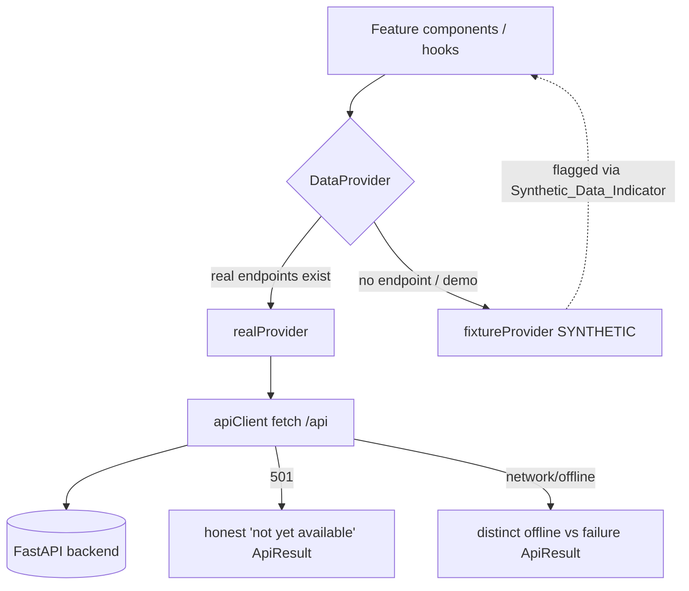
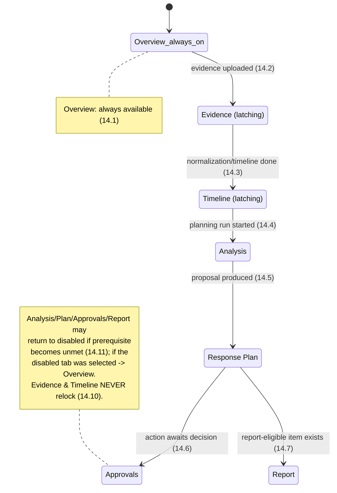
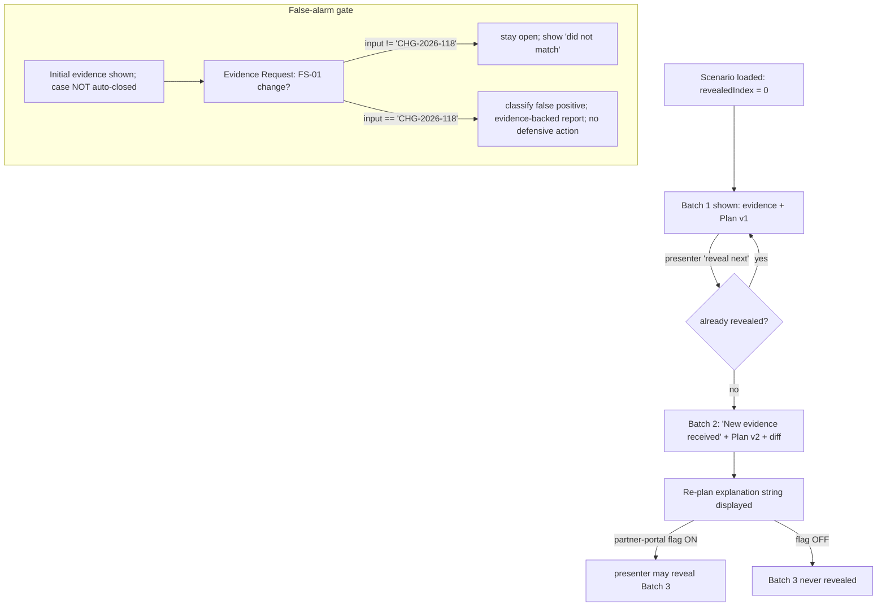

# Design Document

## Overview

This design extends — never rebuilds — the existing Caventas frontend
(React 18 + Vite 5 + TypeScript strict + Tailwind 3 under `frontend/`) to
satisfy the 31 requirements of the progressive-disclosure IA redesign. It
preserves the established `AppShell` (TopBar + Sidebar + off-canvas drawer),
the `createBrowserRouter` routing in `src/app/App.tsx`, the Barlow + IBM Plex
Mono typography, the navy/lime design tokens, and the absolute rule that the UI
contacts the FastAPI backend over HTTP only and never touches Firestore.

The central design problem is **honesty under an incomplete backend**. The
backend today exposes only: `POST /cases`, `GET /cases/{id}`,
`POST /cases/{id}/evidence`, `GET /cases/{id}/evidence`, `GET /cases/{id}/state`,
`POST /cases/{id}/runs`, `GET /cases/{id}/plans`, `GET /health`. Approvals
decisions, execution, and reports return **HTTP 501**. There is **no**
`GET /cases` list endpoint, **no** dashboard-aggregation endpoint, and **no**
audit-list endpoint. The design therefore introduces a disciplined data-access
layer that (a) uses real endpoints where they exist, (b) serves demo scenarios
and the missing aggregates from clearly-labelled synthetic fixtures, and (c)
surfaces 501 features as plain "not yet available" states — never fabricated
success and never silent fabrication of data (Req 29).

The second design problem is **decision legibility** — the four product states
(proposed / approved / executed / effective) and the six Response-Plan
`Action_State`s must stay mutually exclusive and never read as a settled
outcome, with lime reserved for confirmed-effective only.

### Delivery scope

This design is explicit about sequencing so tasks can be ordered:

- **[Core] — first shippable slice:** the data-access layer (`lib/api`); the
  dashboard redesign (Req 1–6); the Create New Case stepper (Req 7–11); demo
  scenario templates shell + the Infostealer main demo (Req 12, 20); the
  Case Workspace header + underline tabs + tab-availability state machine
  (Req 13–14); the CoreUI icon system + About/Credits attribution (Req 25);
  cross-cutting constraints (Req 26–30); and PRODUCT.md accuracy (Req 31).
- **[Follow-on]:** Phishing and False-alarm scenarios (Req 21–22); the deeper
  case tabs — Overview content, Evidence, Timeline, Analysis, Response Plan,
  Approvals, Report (Req 15–19, 23–24) beyond the shells the main demo needs.

## Architecture

### Surface and component map

```
AppShell (existing — preserved)
├── TopBar, Sidebar/SidebarDrawer, ConnectionBanner
└── <Outlet/>
    ├── /                     DashboardPage          [Core, redesigned]
    │   ├── DashboardHeader (eyebrow/heading/sentence, synthetic indicator, Create New Case)   Req 1
    │   ├── OverviewCards (3-col ≥1024)
    │   │   ├── CaseActivityCard        Req 2
    │   │   ├── AgentPlanningCard       Req 3
    │   │   └── HumanDecisionsCard      Req 4
    │   ├── NeedsAttentionSection (≤3)  Req 5
    │   └── RecentCasesTable (≤5)       Req 6
    ├── /cases/new            CreateCasePage         [Core]  Req 7–12
    │   └── SetupPanel (step machine) + DemoScenarioPicker
    ├── /cases/:caseId        CaseWorkspace          [Core shell; Follow-on depth]  Req 13–19,23–24
    │   ├── CaseHeader (persistent)     Req 13
    │   ├── UnderlineTabs (availability-gated)  Req 14
    │   └── nested tab routes (Outlet)
    │       ├── overview   OverviewTab      Req 15 [Follow-on]
    │       ├── evidence   EvidenceTab      Req 16 [Follow-on]
    │       ├── timeline   TimelineTab      Req 17 [Follow-on]
    │       ├── analysis   AnalysisTab      Req 18 [Follow-on]
    │       ├── plan       ResponsePlanTab  Req 19 [Follow-on]
    │       ├── approvals  CaseApprovalsTab Req 23 [Follow-on]
    │       └── report     ReportTab        Req 24 [Follow-on]
    ├── /approvals          ApprovalsPage    [Core shell; Follow-on depth]  Req 23
    ├── /activity           ActivityPage     [Core shell]                   Req 2 feeds from here
    ├── /guidance /reports /settings  existing placeholders (unchanged this feature)
    └── /about              AboutPage        [Core]  Req 25.2 attribution

lib/
├── api/
│   ├── apiClient.ts     fetch wrapper over /api; typed ApiResult
│   ├── provider.ts      DataProvider interface
│   ├── realProvider.ts  real endpoints (GET /cases/{id}, evidence, state, plans)
│   └── fixtureProvider.ts  synthetic aggregates + scenarios (flagged synthetic)
├── selectors/           pure dashboard-aggregate selectors (Req 2–6)
├── scenario/            scenario definitions (data) + ScenarioEngine/useScenario (Req 20–22)
├── caseWorkspace/       tabAvailability() pure fn + tab state (Req 14)
├── setup/               setup step machine (Req 7–11)
├── types.ts             extended domain + UI types
├── format.ts, motion.ts responsive helpers
components/
├── ui/ (existing: Button, StatusBadge, Region, Skeleton, Mono, Toast)  — reused/extended
├── icons/ (new CoreUI Icon module)  Req 25
└── shell/ (existing AppShell etc.)  — preserved
```

### Data-access layering (Req 28, 29) — honest about backend gaps

A single `DataProvider` interface sits between features and the network. Two
implementations satisfy it; a feature never knows which it got. **Real
endpoints are used wherever they exist; everything with no endpoint is served
by a synthetic fixture provider and flagged synthetic.**



Mapping of requirements to data source:

| Capability | Source | Endpoint / note |
|---|---|---|
| Get one case | real | `GET /cases/{id}` |
| Create case | real | `POST /cases` |
| Upload evidence | real | `POST /cases/{id}/evidence` |
| List evidence (counts, items) | real | `GET /cases/{id}/evidence` |
| Current incident state | real | `GET /cases/{id}/state` |
| Start planning run | real | `POST /cases/{id}/runs` |
| List plans | real | `GET /cases/{id}/plans` |
| **Cases list** (dashboard, recent) | **synthetic** | no `GET /cases` — fixture, flagged |
| **Dashboard aggregates** (open count, attention, 7-day activity, stage dist, awaiting, oldest) | **derived client-side** | pure selectors over fixture/case data (Req 2–6) |
| **Audit events** (activity, 7-day buckets) | **synthetic** | no audit-list endpoint — fixture, flagged |
| Approvals decision submit | real but **501** | `POST /cases/{id}/actions/{action_id}/decision` → honest not-implemented |
| Reports / PDF export | real but **501** | `POST/GET /cases/{id}/reports...` → honest not-implemented |
| Demo scenarios (Infostealer/Phishing/False-alarm) | **synthetic** | scenario fixtures, flagged |

The dashboard aggregates are computed by **pure selector functions** over the
provider's data, structured so a future `GET /dashboard` endpoint can replace
the selectors without touching components (the selectors already exist in
spirit as `dashboardSummary()` / `caseStatusBreakdown()` in `mock-data.ts`;
this design formalises and extends them in `lib/selectors/`).

### Tab-availability state machine (Req 14)

`tabAvailability(caseState)` is a **pure function** from observable case facts
to each tab's `{ available, reason? }`. Evidence and Timeline are "latching" —
once available they never return to disabled (Req 14.10). Disabled tabs are
excluded from the keyboard tab order and show a prerequisite tooltip on
hover/focus (Req 14.8–14.9). If the selected tab becomes unavailable, the
workspace falls back to Overview (Req 14.11).



### Scenario batch-reveal flow (Req 20–22)

Scenarios are declarative data (ordered batches); a `ScenarioEngine` holds the
revealed-batch index and advances **only** on an explicit presenter control —
never on a timer (Req 20.2, 21.2). Re-revealing a revealed batch is idempotent
(Req 20.3, 21.3).



## Components and Interfaces

### apiClient (Req 28, 29)

Distinguishes success, HTTP error (incl. 501), network failure, and offline so
features render the correct honest state.

```ts
// lib/api/apiClient.ts
export type ApiResult<T> =
  | { kind: "ok"; data: T }
  | { kind: "http_error"; status: number; message: string }
  | { kind: "not_implemented"; status: 501; message: string } // explicit 501
  | { kind: "network_error"; message: string }                // request failed
  | { kind: "offline" };                                       // navigator offline

export interface ApiClient {
  get<T>(path: string, init?: RequestInit): Promise<ApiResult<T>>;
  post<T>(path: string, body?: unknown, init?: RequestInit): Promise<ApiResult<T>>;
  postForm<T>(path: string, form: FormData): Promise<ApiResult<T>>; // evidence upload
}
// Base path "/api" (Vite proxies -> http://localhost:8000). 501 is mapped to
// not_implemented BEFORE generic http_error so callers can show "not yet
// available" (Req 23.7, 24.3-4, 29.3).
```

### DataProvider (Req 29)

```ts
// lib/api/provider.ts
export interface DataProvider {
  // Real endpoints
  getCase(caseId: string): Promise<ApiResult<CaseDetail>>;
  createCase(input: CreateCaseInput): Promise<ApiResult<CaseDetail>>;
  uploadEvidence(caseId: string, file: File): Promise<ApiResult<EvidenceUploadResult>>;
  listEvidence(caseId: string): Promise<ApiResult<EvidenceItem[]>>;
  getState(caseId: string): Promise<ApiResult<IncidentState>>;
  startRun(caseId: string): Promise<ApiResult<PlanningRunRef>>;
  listPlans(caseId: string): Promise<ApiResult<Plan[]>>;
  // 501 today — must surface not_implemented honestly
  submitDecision(caseId: string, actionId: string, d: DecisionInput): Promise<ApiResult<never>>;
  generateReport(caseId: string): Promise<ApiResult<never>>;
  // Synthetic / derived (no endpoint) — provider marks source: "synthetic"
  listCases(): Promise<ApiResult<CaseSummary[]>>;        // SYNTHETIC
  listAuditEvents(): Promise<ApiResult<AuditEvent[]>>;   // SYNTHETIC
}
export interface Sourced<T> { data: T; source: "real" | "synthetic"; }
```

`fixtureProvider` returns `source: "synthetic"` for cases/audit/scenarios so
the UI can attach a `Synthetic_Data_Indicator` (Req 29.5). `realProvider`
returns `source: "real"`.

### Dashboard selectors (Req 2–6)

Pure functions; replaceable by a future `GET /dashboard`.

```ts
// lib/selectors/dashboard.ts
export function openCaseCount(cases: CaseSummary[]): number;          // 2.1,3? 
export function attentionItems(cases: CaseSummary[], runs: AgentRun[], approvals: PendingApproval[]): AttentionItem[]; // 5.1 ordering
export function sevenDayActivity(events: AuditEvent[], now: Date): DayBucket[]; // 2.2 (7 trailing day buckets)
export function stageDistribution(runs: AgentRun[]): Array<{ stage: Stage; count: number }>; // 3.2 ordered by workflow sequence
export function humanDecisions(approvals: PendingApproval[], now: Date): {
  awaiting: number; escalations: number; oldestWaiting: Duration | null;        // 4.1-4.3 (null, not zero)
  distribution: Array<{ key: string; count: number }>;
};
```

Ordering rules are encoded here: Needs Attention picks the three earliest
waiting-since, ties by descending escalation then ascending title (Req 5.1);
Recent Cases picks five most-recently-updated, ties by ascending title (Req 6.1).

### Case Workspace tab machine (Req 14)

```ts
// lib/caseWorkspace/tabAvailability.ts
export type TabId =
  | "overview" | "evidence" | "timeline" | "analysis"
  | "plan" | "approvals" | "report";

export interface CaseFacts {
  evidenceUploaded: boolean;
  timelineReconstructed: boolean;
  planningRunStarted: boolean;
  proposalExists: boolean;
  actionAwaitingDecision: boolean;
  reportEligibleItemExists: boolean;
}
export interface TabStatus { available: boolean; reason?: string; }

// Pure. Caller passes previous availability so Evidence/Timeline latch (14.10).
export function tabAvailability(
  facts: CaseFacts,
  prev?: Record<TabId, TabStatus>,
): Record<TabId, TabStatus>;

// Selected-tab fallback when its tab became unavailable (14.11).
export function resolveSelectedTab(
  requested: TabId,
  availability: Record<TabId, TabStatus>,
): TabId; // returns "overview" when requested is unavailable
```

Tabs render as deep-linkable nested routes (`/cases/:caseId/evidence`, etc.) —
chosen over internal state because deep links are an operational need (sharing
a specific tab) and keep the back button meaningful. The parent
`CaseWorkspace` route owns the header and the tab bar; the active tab renders
through an `<Outlet/>`. A disabled tab is rendered as a non-focusable element
(`aria-disabled`, removed from tab order) with a prerequisite tooltip
(Req 14.8–14.9); navigating directly to a disabled tab's URL redirects to
`overview` (Req 14.11).

### Setup step machine (Req 7–11)

```ts
// lib/setup/stepMachine.ts
export type StepId = "details" | "evidence" | "review" | "start";
export type StepStatus = "locked" | "active" | "complete";

export interface SetupState {
  current: StepId;
  values: {
    title: string; description: string; note: string; scenarioId?: string;
    caseId?: string;                 // set after POST /cases
    acceptedFiles: EvidenceUploadResult[];
    reviewConfirmed: boolean;
    runStarted: boolean;             // duplicate-run guard (11.4)
  };
}
export function stepStatuses(s: SetupState): Record<StepId, StepStatus>;
export function prerequisiteReason(step: StepId, s: SetupState): string | null; // disabled explanation (7.3)
export function editEarlier<K extends keyof SetupState["values"]>(
  s: SetupState, key: K, value: SetupState["values"][K],
): SetupState; // invalidates the containing step and all later ones (7.6)
```

Step wiring to real endpoints:
- **Step 1 (details)** gates Step 2 on a valid title (non-empty, non-whitespace,
  ≤200 chars) (Req 8.3). The case is created with `POST /cases` on the
  transition into Step 2 so a `caseId` exists before any upload.
- **Step 2 (evidence)** uploads each accepted file with
  `POST /cases/{caseId}/evidence`; client-side pre-checks reject wrong type and
  >10 MB before upload (Req 9.3, 9.5); a backend 400 (malformed) is surfaced as
  a malformed-record error (Req 9.4). Advanced fields stay hidden until one file
  is accepted (Req 9.6); Step 3 gated on ≥1 accepted file (Req 9.7).
- **Step 3 (review)** reads `GET /cases/{caseId}/evidence` for accepted count,
  detected sources, and rejected/malformed counts — shown exactly as returned
  (Req 10.1); SHA-256 + ingestion status shown only on explicit request
  (Req 10.2); requires a confirm; changing evidence clears the confirm
  (Req 10.3–10.5).
- **Step 4 (start)** shows the summary incl. current `State_Version` (from
  `GET /cases/{caseId}/state`) and calls `POST /cases/{caseId}/runs` once; the
  `runStarted` flag prevents a duplicate run (Req 11.4); a failed run surfaces
  an honest error and no false success (Req 11.5).

### Scenario / Batch / PlanDiff (Req 20–22)

```ts
// lib/scenario/types.ts
export interface ScenarioDef {
  id: "infostealer" | "phishing" | "false-alarm";
  title: string; badge: "Main demo" | "Light scenario" | "False alarm";
  oneLine: string;
  orgLabel: string;             // from ONE config value "Caventas Demo Organisation" (12.3)
  partnerPortalFlag: boolean;   // gates Batch 3 (20.7-20.8)
  batches: BatchDef[];
  evidenceRequest?: EvidenceRequestGate; // false-alarm only (22)
}
export interface BatchDef {
  index: number;
  announcement?: string;        // "New evidence received" (20.4)
  evidence: EvidenceItem[];
  plan: Plan;                   // versioned (Plan v1, v2 ...)
  diff?: PlanDiff;              // present on Batch 2 (20.5)
  replanExplanation?: string;   // exact string (20.6)
}
export type DiffCategory = "unchanged" | "added" | "replaced_or_insufficient" | "policy_triggered";
export interface PlanDiff {
  // every v2 action assigned to exactly one category — MECE (20.5)
  entries: Array<{ action: StoredActionView; category: DiffCategory }>;
}
export interface EvidenceRequestGate {
  question: string;             // "Was there an approved change for FS-01 last night?"
  expectedReference: "CHG-2026-118"; // exact match required (22.3-22.5)
}

// lib/scenario/engine.ts
export interface ScenarioEngine {
  readonly revealedIndex: number;
  revealNext(): void;           // explicit presenter control only; idempotent at end
  revealBatch(i: number): void; // idempotent re-reveal (20.3)
  canRevealBatch(i: number): boolean; // honours partnerPortalFlag for Batch 3
  submitEvidenceReference(input: string): "matched" | "no_match"; // CHG gate
}
export function useScenario(def: ScenarioDef): ScenarioEngine;
```

A scenario maps onto the **same** Case Workspace surfaces: a scenario-backed
case is just a `DataProvider` whose data is driven by the engine's revealed
batches, so Evidence/Timeline/Analysis/Response Plan tabs render identically
for demo and real data. Held-back timeline evidence is gated by
`revealedIndex` (Req 17.3). Timers are never used to advance a batch.

### Six Action_States + plan diff badges (Req 19)

The Response Plan tab requires six mutually exclusive states; the current
frontend's five (`proposed/approved/executed/effective/failed`) are reconciled
to the spec's six:

```ts
// lib/types.ts
export type PlanActionState =
  | "proposed" | "approved" | "simulated"
  | "validated_effective" | "validated_ineffective" | "superseded";
```

Reconciliation: dashboard-level `ActionState` (the four/five legible display
states) stays for the Approvals/dashboard context; the Response Plan tab uses
the new `PlanActionState`. `executed` → `simulated`; `effective` →
`validated_effective`; `failed` → `validated_ineffective`; `superseded` is new.
A `PlanActionStateBadge` extends the existing `StatusBadge` tone system:
`simulated` = info tone (distinct), `validated_effective` = accent/lime
(confirmed only), `validated_ineffective` = danger, `superseded` = neutral.
Simulated and Validated-effective are never collapsed (Req 19.6); lime appears
only on validated-effective.

### CoreUI Icon component (Req 25)

```ts
// components/icons/Icon.tsx
export type IconName =
  | "dashboard" | "cases" | "approvals" | "guidance" | "reports"
  | "activity" | "settings" | "evidence" | "timeline" | "analysis"
  | "responsePlan" | "humanDecision" | "report"
  | "endpoint" | "identity" | "network" | "email" | "file"
  | "warning" | "success" | "blocked" | "running";
export interface IconProps { name: IconName; size?: 18 | 20 | 24; title?: string; className?: string; }
export function Icon(props: IconProps): JSX.Element; // stroke uses currentColor
```

A curated subset of **CoreUI Icons** (`@coreui/icons`, artwork CC BY 4.0 → MIT
code) is stored locally as inlined SVG paths in a single record; `<Icon>`
indexes it. Nav icons render at 20px, workflow/empty-state at 24px, never below
18px (Req 25.3–25.5). Every icon is paired with a label; icon-only buttons get
an accessible name + tooltip (Req 25.6–25.7, 30.1). Migration from
`lucide-react` is a call-site replacement: swap `<Lucide .../>` for
`<Icon name=... />`; `lucide-react` is removed once no call sites remain.
Attribution is rendered on `/about` (Req 25.2).

Semantic → CoreUI mapping (chosen set, one family):

| Semantic | CoreUI icon | Semantic | CoreUI icon |
|---|---|---|---|
| dashboard | `cil-speedometer` | report | `cil-file` |
| cases | `cil-folder` | endpoint | `cil-laptop` |
| approvals | `cil-check-circle` | identity | `cil-user` |
| guidance | `cil-book` | network | `cil-globe-alt` |
| reports | `cil-description` | email | `cil-envelope-closed` |
| activity | `cil-list` | file | `cil-file` |
| settings | `cil-settings` | warning | `cil-warning` |
| evidence | `cil-folder-open` | success | `cil-check-circle` |
| timeline | `cil-clock` | blocked | `cil-ban` |
| analysis | `cil-chart` | running | `cil-reload` |
| responsePlan | `cil-list-rich` | humanDecision | `cil-user-follow` |

### Motion util (Req 26)

```ts
// lib/motion.ts
export const motion = {
  tabFade: "transition-opacity duration-150",     // 120-160ms (26.1)
  panelEnter: "transition-transform duration-200", // 180-220ms (26.2)
  stepComplete: "transition duration-300",          // ≤300ms (26.3)
  evidencePulse: "animate-evidence-once",           // single ≤500ms, no repeat (26.4)
};
// A global `@media (prefers-reduced-motion: reduce)` rule REMOVES these
// (sets transition/animation: none) rather than shortening them (26.5).
// No continuously-animated charts (26.6 / 2.7).
```

## Data Models

Additions and changes in `lib/types.ts` (existing types preserved unless noted):

```ts
// ADD — classification/severity surfaced on cases (Req 6.3, 13.1)
export type Severity = "low" | "medium" | "high" | "critical";
export interface CaseSummary {           // CHANGE: add fields
  caseId: string; title: string; status: CaseStatus;
  recoveryStatus: RecoveryStatus; stateVersion: number; updatedAt: string;
  classification?: string;               // ADD (Recent Cases column)
  severity?: Severity;                   // ADD (case header)
  stage?: Stage;                         // ADD (Recent Cases "current Stage")
}
export interface CaseDetail extends CaseSummary { /* mirrors GET /cases/{id} */ }

// ADD — Evidence tab filters (Req 16.1)
export type EvidenceCategory =
  | "endpoint" | "identity" | "network" | "application" | "analyst_note";
export interface EvidenceItemView {      // view model over backend EvidenceItem
  evidenceId: string; sourceFile: string; sha256: string;
  kind: "csv" | "json" | "txt"; category: EvidenceCategory;
  eventTime?: string; title: string; observed: boolean;
}

// ADD — planning run presentation (dashboard + analysis)
export interface AgentRun { /* existing */ }         // reused
export interface PlanningRunRef { runId: string; caseId: string; stage: Stage; }
export interface Plan { planId: string; version: number; stage: Stage;
  actions: StoredActionView[]; missingEvidence: string[]; }
export interface StoredActionView {
  actionId: string; version: number; toolName: string; targetId: string;
  targetType: EntityType; risk: "low" | "moderate" | "high";
  escalationRequired: boolean; state: PlanActionState;
  rationale: string; policyRefs: string[]; expectedEffect: string;
  validationChecks: string[]; basedOnStateVersion: number;
}

// ADD — dashboard aggregate shapes
export interface DayBucket { date: string; count: number; }
export interface Duration { value: number; unit: "d" | "h" | "m"; }
export interface AttentionItem extends CaseSummary {
  reason: AttentionReason; waitingSince: string; escalationLevel: number;
}

// ADD — IconName, TabId, StepId, Scenario/Batch/PlanDiff (shown above)
```

Unchanged backend-mirroring types (`CaseStatus`, `RecoveryStatus`, `Stage`,
`EntityType`, `IncidentState`, `PendingApproval`, `AuditEvent`, four-state
`ActionState`) remain; `PlanActionState` is **added** for the Response Plan tab
and does not replace `ActionState`.

## Error Handling

- **501 (approvals submit, reports, PDF export)** — `apiClient` maps 501 to
  `not_implemented`; the surface shows a plain "This capability is not yet
  available" note (reuse `PendingBackendNote`), disables the control, and never
  shows success (Req 23.7, 24.3–24.4, 29.3). PDF export control is rendered
  disabled + labelled unavailable; activating it does nothing (Req 24.3–24.4).
- **Network failure vs offline** — `apiClient` returns `network_error` when a
  request fails and `offline` when `navigator.onLine` is false; features render
  distinct states and the existing `ConnectionBanner`/`useOnlineStatus`
  distinguish them (Req 29.1–29.2).
- **Upload rejections** — wrong file type and >10 MB are rejected client-side
  before the request with specific messages (Req 9.3, 9.5); a backend 400
  surfaces as a malformed-record error (Req 9.4). Rejected counts shown in Step
  3 come from the backend, never fabricated (Req 10.1).
- **Start-analysis failure** — a failed `POST /cases/{id}/runs` shows an honest
  error and keeps `runStarted` false so no false success and no duplicate guard
  misfire (Req 11.5); if a run already started, no duplicate request is sent
  (Req 11.4).
- **Approval-comment validation** — Reject / Request-more-investigation require
  a comment with ≥1 non-whitespace char; empty/whitespace blocks submission with
  a validation message (Req 23.5–23.6) — enforced client-side before the (501)
  call.
- **Loading / empty / error on every data surface** — each card, list, table,
  and tab provides loading (skeletons, not full-page spinners), honest empty,
  and error states (Req 2–6, 29.1); no stale/placeholder values are presented
  as current (Req 2.3/2.5, 3.3/3.5, 4.5/4.7, 5.6/5.8, 6.5/6.7).

## Testing Strategy

Property-based testing (PBT) is **not** adopted here: this is a UI redesign
(React rendering, routing, layout) over an existing backend, which the
requirements-first guidance explicitly lists as a case for example-based and
snapshot tests rather than universal properties. Instead:

- **Type safety / build** — `tsc --strict` must pass and `vite build` must
  succeed; these are the first gate for every change (Req 28.1).
- **Unit tests (Vitest)** for the pure logic, which is where correctness
  concentrates:
  - `selectors/dashboard`: open count, 7-day bucketing boundaries (Req 2.2),
    stage distribution ordering (Req 3.2), oldest-waiting single-largest-unit
    and the null-not-zero rule (Req 4.2–4.3), attention ordering + ≤3 (Req 5.1),
    recent ordering + ≤5 (Req 6.1).
  - `caseWorkspace/tabAvailability`: each transition (Req 14.2–14.7), the
    Evidence/Timeline latch (Req 14.10), disabled-exclusion, and
    `resolveSelectedTab` fallback to Overview (Req 14.11).
  - `setup/stepMachine`: title validation (Req 8.3), edit-earlier invalidation
    (Req 7.6), backward-nav value preservation (Req 7.7), duplicate-run guard
    (Req 11.4).
  - `scenario/engine`: idempotent re-reveal (Req 20.3), presenter-only
    advancement (no timer), Batch-2 diff is MECE over v2 actions (Req 20.5), the
    exact re-plan explanation + "New evidence received" strings (Req 20.4,
    20.6), partner-portal Batch-3 gate (Req 20.7–20.8), and the false-alarm
    `CHG-2026-118` exact-match gate incl. no-match retention (Req 22.3–22.5).
  - `apiClient`: 501 → `not_implemented`, network vs offline mapping.
- **Component tests** for honest states: 501 surfaces show the not-implemented
  note (Req 23.7, 24.3), empty/error states render without fabricated values.
- **Manual checks** recorded in frontend docs: responsive at 320/768/1024/1920
  with no horizontal overflow (Req 27.4), `prefers-reduced-motion` removes
  motion (Req 26.5), keyboard operability + visible focus and no status-by-
  colour-alone (Req 30.2–30.4), WCAG AA contrast on the navy shell.

## Correctness Properties

Although formal PBT is not used, these invariants MUST hold and are the basis
for the unit tests above:

### Property 1: Four/six-state separation

**Validates: Requirements 19.5, 19.6**

A Response Plan action is in exactly one
   `PlanActionState`; `simulated` and `validated_effective` are never equal and
   never rendered as one another (Req 19.5–19.6). Lime appears only on
   `validated_effective`/confirmed (Req 19, brand rules).

### Property 2: No fabrication

**Validates: Requirements 29.4, 29.5**

Every displayed value is either from a real endpoint or
   from a fixture flagged with a `Synthetic_Data_Indicator`; no evidence,
   evidence IDs, metrics, or outcomes are invented (Req 29.4–29.5).

### Property 3: No real-execution claims

**Validates: Requirements 19.7, 20.9, 21.5, 22.6**

No scenario or action surface states that real
   infrastructure was modified (Req 19.7, 20.9, 21.5, 22.6).

### Property 4: Deterministic, presenter-driven batch advancement

**Validates: Requirements 20.2, 20.3, 21.2, 21.3**

`revealedIndex`
   changes only via explicit presenter control, never a timer; re-revealing is
   idempotent (Req 20.2–20.3, 21.2–21.3).

### Property 5: Evidence/Timeline never hard-lock

**Validates: Requirements 14.10, 14.11**

Once available they never return to
   disabled; other tabs may relock, and relocking the selected tab falls back
   to Overview (Req 14.10–14.11).

### Property 6: Honest 501

**Validates: Requirements 23.7, 24.3, 24.4, 29.3**

A 501 response always yields a "not yet available" state and
   never a success (Req 23.7, 24.3–24.4, 29.3).

### Property 7: Exact-match gate

**Validates: Requirements 22.3, 22.4, 22.5**

The false-alarm case is classified a false positive
   only on an input exactly equal to `CHG-2026-118` (Req 22.3–22.5).

## Requirement-to-section map

| Requirement | Design section |
|---|---|
| 1–6 Dashboard | Architecture (surface map, selectors), Components (selectors), Error Handling |
| 7–11 Create case | Components (Setup step machine), Error Handling |
| 12 Demo templates | Components (Scenario types; orgLabel single config), Architecture |
| 13–14 Case Workspace + tabs | Architecture (tab state machine diagram), Components (tabAvailability) |
| 15–19 Case tabs + 6 states | Components (StoredActionView, PlanActionState badges) |
| 20–22 Scenarios | Architecture (batch flow diagram), Components (Scenario/Batch/PlanDiff, engine) |
| 23 Approvals | Components (DataProvider.submitDecision 501), Error Handling |
| 24 Report | Components (generateReport 501), Error Handling |
| 25 Icons | Components (Icon module + mapping) |
| 26 Motion | Components (motion util) |
| 27 Responsive | Components/Architecture (breakpoint strategy) |
| 28–30 Boundaries, honesty, a11y | Architecture (data layering), Error Handling, Testing |
| 31 PRODUCT.md | PRODUCT.md updates (below) |

## PRODUCT.md updates (Req 31)

This feature will update `PRODUCT.md` to:

1. Record durable decisions for **Information Architecture** (global overview →
   focused per-case pages with underline tabs), **Progressive Disclosure**
   (dashboard shows only enough to decide where to go; detail lives on case
   surfaces; step-wise case creation), **Scenario-Based Demonstration**
   (presenter-driven synthetic scenarios: Infostealer main demo, Phishing,
   False-alarm), and **Action Boundary** (recommend/approve/simulate only; no
   real execution).
2. State interface typography as **Barlow** and **remove the stale "IBM Plex
   Sans"** note (Req 31.2–31.3). (IBM Plex Mono stays for identifiers.)
3. Keep icon filenames, route metadata, and component specs **out** of
   PRODUCT.md — those live in this design.md / frontend docs (Req 31.4).

## Responsive strategy (Req 27)

Reuses the existing Tailwind token/breakpoint approach:

- **≥1024px:** persistent sidebar, 3-column overview cards, optional right side
  panel (Req 27.1).
- **768–1023px:** collapsible sidebar, reflowed cards, horizontally scrollable
  underline tabs (Req 27.2).
- **≤767px:** off-canvas navigation (existing `SidebarDrawer`), one card per
  row, scrollable tabs, side panels become full-screen sheets, tables become
  compact lists (Req 27.3).
- No horizontal overflow across 320–1920px (Req 27.4), verified manually.
