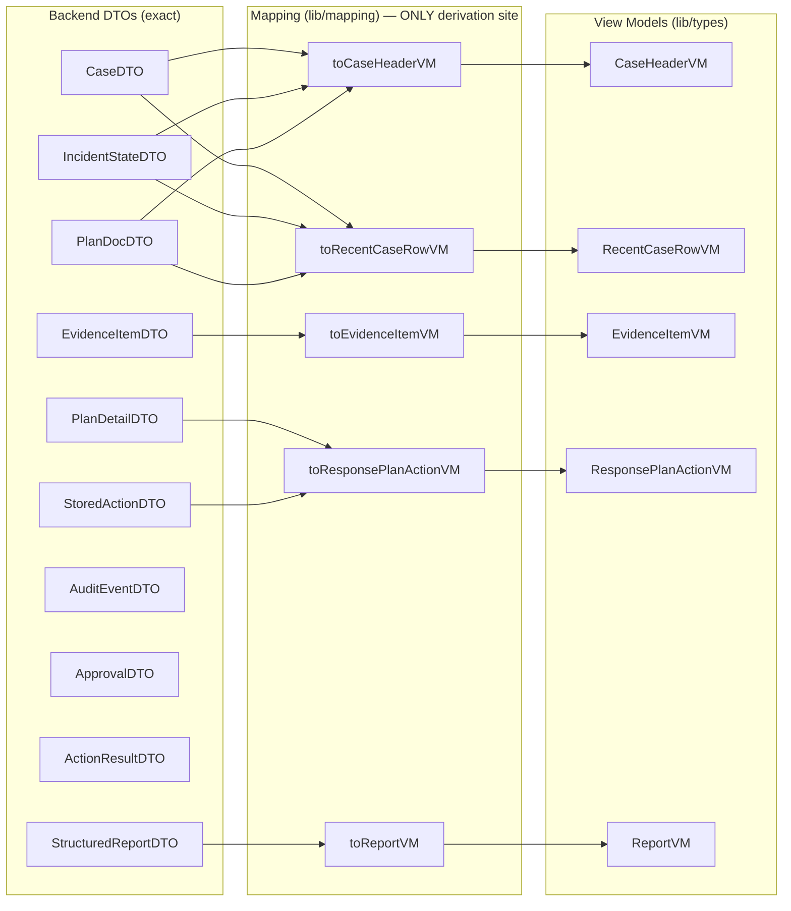
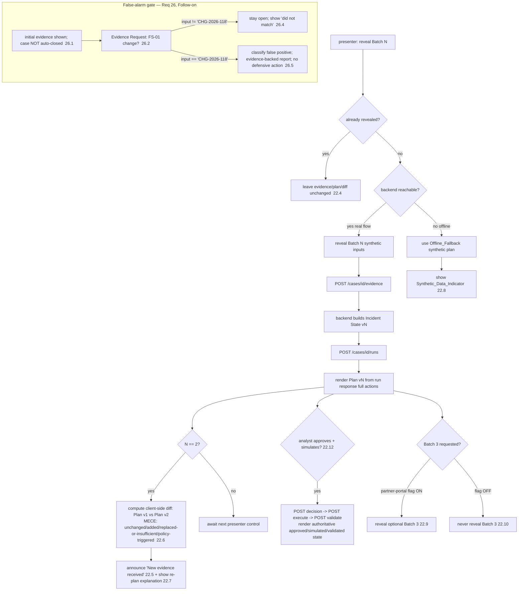

# Design Document

## Overview

This design extends — never rebuilds — the existing Caventas system to satisfy
the 35 requirements of the progressive-disclosure IA redesign. The scope now
spans **both** the React frontend (React 18 + Vite 5 + TypeScript strict +
Tailwind 3 under `frontend/`) **and the FastAPI backend** (`backend/app`),
because the first shippable slice requires the full vertical flow:
evidence → incident state → plan → human decision → bounded simulation →
effect validation → structured report.

On the frontend side the design preserves the established `AppShell` (TopBar +
Sidebar + off-canvas drawer), the `createBrowserRouter` routing in
`src/app/App.tsx`, the Barlow + IBM Plex Mono typography, the navy/lime design
tokens, and the absolute rule that the UI contacts the FastAPI backend over
HTTP only and never touches Firestore (Req 30).

On the backend side the design implements five endpoints that were previously
HTTP 501 stubs or missing, following the existing codebase conventions:
routers in `app/api/`, services in `app/services/`, Pydantic schemas in
`app/schemas/`, and all Firestore access through
`app/database/repositories.py` (Firebase Admin SDK; per-case subcollections
`evidence`, `state_versions`, `plans`, `actions`, `approvals`,
`action_results`, `audit_events`, `reports`). The newly-implemented backend
work is bound by the security rules in `.kiro/steering/security.md`:

- **AI output is never authorization.** `planning_service.run_planning`
  persists `StoredAction` docs; approval is a separate, analyst-driven write.
- **Simulation runs only via a valid, non-stale approval**, and only through
  the bounded `app/simulator/simulator_adapter.py` — never real infrastructure.
- **Incident state is versioned and append-only**; plans and actions are
  append-only; prior versions are retained.
- **Every meaningful activity emits an `Audit_Event`** via `audit_service`,
  surfaced per case through `GET /cases/{id}/audit`.

### The two central design problems

**1. Decision legibility.** The conceptual four product states (proposed /
approved / executed / effective) are the lineage of the human-in-the-loop
principle, but the authoritative enumerated model is the **single canonical
six-value `Action_State`**: `proposed`, `approved`, `simulated`,
`validated_effective`, `validated_ineffective`, `superseded` (Req 20). This
model now lives **authoritatively on the backend action document** and is
reflected by the frontend; the UI must never blur a recommendation with a
confirmed outcome, and lime is reserved for `validated_effective` only.

**2. Honesty under a now-mostly-implemented backend.** Five endpoints move from
stub/missing to **Core, implemented in this feature**. What remains genuinely
absent is small and explicitly flagged synthetic. The verified backend contract
after this feature is:

**Real endpoints (existing + the five newly implemented by this feature):**

| Method + path | Returns | Notes |
|---|---|---|
| `POST /cases` | `Case` | title/description only on input |
| `GET /cases/{id}` | `Case` | `case_id, title, description, status, current_state_version, created_at, updated_at` — **no** severity/classification/stage/recovery_status |
| `POST /cases/{id}/evidence` | `EvidenceUploadResult` | `source_file, sha256, kind, item_count, evidence_ids, new_state_version`; **400** on malformed, **404** on missing case |
| `GET /cases/{id}/evidence` | `EvidenceItem[]` | normalized records |
| `GET /cases/{id}/state` | `IncidentState` (versioned) | integer `version`; append-only |
| `POST /cases/{id}/runs` | run response with the Plan plus **FULL** action documents; persists `StoredAction` docs | the only place complete *just-run* actions are available |
| `GET /cases/{id}/plans` | `Plan[]` | `plan_id, …, action_ids[], created_at` — **`action_ids` only**, not full actions |
| **`GET /cases/{id}/plans/{plan_id}`** | **`PlanDetail`** — plan + **full embedded `StoredAction`s** incl. current `Action_State` | **NEW (Core, Req 32)** — historical reload after refresh |
| **`POST /cases/{id}/actions/{action_id}/decision`** | **`Approval`** | **NEW (Core, Req 23)** — binds decision; approve → `approved` |
| **`POST /cases/{id}/actions/{action_id}/execute`** | **`ActionResult`** | **NEW (Core, Req 22/21)** — bounded simulation; → `simulated` then validation |
| **`POST /cases/{id}/reports`** | **`StructuredReport`** | **NEW (Core, Req 24)** — generate from records |
| **`GET /cases/{id}/reports/{report_id}`** | **`StructuredReport`** | **NEW (Core, Req 24)** — retrieve |
| `GET /cases/{id}/audit` | `AuditEvent[]` | **real, per-case** audit events |
| `GET /health` | health | existing |

**Still absent after this feature (optional / Follow-on, degraded honestly):**

- Global `GET /cases` list → dashboard/recent-cases use a **clearly-labelled
  synthetic** fixture (Req 2–6).
- Global audit endpoint → per-case `GET /cases/{id}/audit` only.
- Planning-run lifecycle/status endpoint → dashboard active/blocked run counts
  are **explicitly synthetic**, never inferred from Stage (Req 3.2–3.3).
- `PATCH /cases/{id}` → **does not exist by decision**; after creation, title
  and description are read-only and no update endpoint is ever called (Req 9).
- PDF export/rendering → **Follow-on**; the structured JSON report is Core.

### Delivery scope

- **[Core] — first shippable slice (the full vertical demo flow):** the
  frontend data-access layer (`lib/api`) and DTO→VM mapping; the dashboard
  redesign (Req 1–6); the Create New Case stepper with correct `POST /cases`
  timing and read-only-after-creation honesty (Req 7–12); demo scenario
  templates shell and the Infostealer main demo orchestrated against the real
  backend, now including the real approval→simulate→validate path (Req 13, 22);
  the Case Workspace header + underline tabs + tab-availability state machine
  (Req 14–15); the minimum-viable Overview, Evidence, Timeline, Analysis,
  Response Plan, Approvals, and Report tabs (Req 16–20, 23, 24); the
  human-control invariants **enforced in the backend** and reflected by the UI
  (Req 21); the single canonical six-state model (Req 20); the **CoreUI Icons
  Free** icon system + About/Credits attribution (Req 27); restrained motion
  (Req 28); responsive layout (Req 29); stack/shell/boundary preservation
  (Req 30); honesty constraints (Req 31); and the **Core backend endpoints** —
  approvals decision, bounded simulation execution, effect validation, the
  plan-detail endpoint (Req 32), and structured report generation (Req 24);
  accessibility (Req 33); the mandatory automated tests, now including backend
  tests (Req 34); and PRODUCT.md accuracy (Req 35).
- **[Follow-on]:** PDF export/rendering (Req 24.7); the Phishing scenario
  (Req 25) and the False-alarm scenario (Req 26); and the deeper
  richness/polish of the case tabs beyond their minimum-viable depth.

## Architecture

### Full-system surface map

```
FastAPI backend (backend/app) — Core work in this feature
├── app/api/
│   ├── cases.py        POST /cases, GET /cases/{id}                 (existing)
│   ├── evidence.py     POST/GET /cases/{id}/evidence                (existing)
│   ├── planning.py     POST /cases/{id}/runs, GET /cases/{id}/plans (existing)
│   │                   GET /cases/{id}/plans/{plan_id}              [NEW Req 32]
│   ├── approvals.py    POST /cases/{id}/actions/{action_id}/decision [NEW Req 23]
│   ├── execution.py    POST /cases/{id}/actions/{action_id}/execute  [NEW Req 22/21]
│   │                   POST /cases/{id}/actions/{action_id}/validate [NEW Req 21]
│   │                   GET /cases/{id}/audit                        (existing)
│   └── reports.py      POST /cases/{id}/reports                      [NEW Req 24]
│                       GET /cases/{id}/reports/{report_id}           [NEW Req 24]
├── app/services/
│   ├── ingestion, state_manager, planning_service, audit_service    (existing)
│   ├── approval_service.py    decide(), staleness rule, binding      [NEW]
│   ├── execution_service.py   simulate(), validate_effect()          [NEW]
│   └── reporting.py           build_report() from records            [NEW]
├── app/schemas/        case, evidence, incident_state, plan          (existing)
│                       approval.py, action_result.py, report.py      [NEW]
├── app/simulator/simulator_adapter.py   bounded, synthetic           (existing contract)
└── app/database/repositories.py   + get_plan, get_action,            (extend)
                                     list_actions, add_approval,
                                     list_approvals, add_action_result,
                                     update_action, add_report, get_report

Frontend (frontend/) — preserves AppShell, routing, tokens
AppShell (existing — preserved)
├── TopBar, Sidebar/SidebarDrawer, ConnectionBanner
└── <Outlet/>
    ├── /                     DashboardPage          [Core, redesigned]  Req 1–6
    ├── /cases/new            CreateCasePage         [Core]  Req 7–13
    │   └── SetupPanel (step machine) + DemoScenarioPicker
    ├── /cases/:caseId        CaseWorkspace          [Core]  Req 14–24
    │   ├── CaseHeader (persistent, from CaseHeaderVM)   Req 14
    │   ├── UnderlineTabs (availability-gated)           Req 15
    │   └── nested tab routes (Outlet)
    │       ├── overview   OverviewTab      Req 16
    │       ├── evidence   EvidenceTab      Req 17
    │       ├── timeline   TimelineTab      Req 18
    │       ├── analysis   AnalysisTab      Req 19
    │       ├── plan       ResponsePlanTab  Req 20
    │       ├── approvals  CaseApprovalsTab Req 23
    │       └── report     ReportTab        Req 24
    ├── /approvals          ApprovalsPage    [Core]  Req 23
    ├── /activity           ActivityPage     [Core shell]  feeds Case Activity (Req 2)
    ├── /guidance /reports /settings  existing placeholders (unchanged)
    └── /about              AboutPage        [Core]  Req 27.5 attribution

frontend/src/lib/
├── api/
│   ├── apiClient.ts     typed ApiResult (ok/http_error/not_implemented/network_error/offline)
│   ├── dto.ts           EXACT backend DTO types (+ Approval, ActionResult, PlanDetail, StructuredReport)
│   ├── provider.ts      DataProvider interface
│   ├── realProvider.ts  ALL real endpoints incl. decision/execute/validate/plan-detail/reports
│   └── fixtureProvider.ts  synthetic global cases list + synthetic run counts ONLY
├── mapping/             dto → view-model mapping fns (the ONLY place derivation happens)
├── selectors/           pure dashboard-aggregate selectors (Req 2–6)
├── scenario/            scenario definitions + ScenarioEngine/useScenario (Req 22,25,26)
├── caseWorkspace/       tabAvailability() pure fn + tab state (Req 15)
├── setup/               setup step machine (Req 7–12)
├── approvals/           client-side staleness pre-warn (backend is source of truth) (Req 21)
├── types.ts, format.ts, motion.ts
components/
├── ui/ (existing)  — reused/extended
├── icons/ (CoreUI Icons Free Icon module)  Req 27
└── shell/ (existing AppShell etc.)  — preserved
```

## Backend Design (Core)

This section specifies the five newly-in-scope backend endpoints and their
services. All of it obeys the security rules: AI output never authorizes;
simulation runs only through the bounded simulator and only via a valid
non-stale approval; incident state is versioned/append-only; plans and actions
are append-only; and every decision, simulation, and validation is
audit-recorded.

### Action_State persistence and transitions (Req 20.5–20.6, 21.5–21.6)

The six-value `Action_State` is persisted on the **action document** in the
per-case `actions` subcollection. `StoredAction` gains an `action_state` field
(default `proposed` when `planning_service.run_planning` first writes it) and a
small, append-only `state_history` list recording each transition with a
timestamp and the audit id that recorded it. Transitions are written through
`repositories.update_action(case_id, action_id, patch)` and are the **only**
way `action_state` changes:

```
proposed ──approve decision──▶ approved ──execute (valid approval)──▶ simulated
                                                                         │
                                              validate_effect ───────────┤
                                                                         ▼
                                              validated_effective | validated_ineffective

(any state) ──newer plan version replaces this action──▶ superseded
```

- `proposed → approved`: written by `approval_service.decide` only on an
  `approve` decision that passes the binding + staleness checks.
- `approved → simulated`: written by `execution_service.simulate` only when the
  action carries a valid, non-stale `approved` approval.
- `simulated → validated_effective | validated_ineffective`: written by
  `execution_service.validate_effect`. `simulated` and `validated_effective`
  are **distinct persisted states** and never collapsed into one another.
- `* → superseded`: written when a newer plan version produces a replacement
  for the same `(tool_name, target_id)`; the prior action doc is retained
  (append-only) and marked `superseded`, never deleted or overwritten.

`StoredAction.version` + `based_on_state_version` continue to bind an action to
one exact revision and one exact `IncidentState`, so an approval of version 1
can never authorize version 2.

### Approvals decision — `POST /cases/{case_id}/actions/{action_id}/decision`

Router `app/api/approvals.py` (replaces the 501 stub) delegates to
`app/services/approval_service.py`.

**Schema (`app/schemas/approval.py`):**

```python
class Decision(str, Enum):
    APPROVE = "approve"
    REJECT = "reject"
    REQUEST_MORE_INVESTIGATION = "request_more_investigation"

class DecisionInput(BaseModel):
    decision: Decision
    comment: str = ""
    decided_by: str = "analyst"

class Approval(BaseModel):
    approval_id: str                 # "APR-{hex12}"
    case_id: str
    action_id: str
    action_version: int              # bound to the exact action revision
    based_on_state_version: int      # bound to the exact IncidentState
    decision: Decision
    comment: str
    decided_at: datetime
    decided_by: str
    invalidated: bool = False        # set True when a later state supersedes it
```

**`approval_service.decide(case_id, action_id, input)` rules:**

1. Load the action via `repositories.get_action`; `404` if the case or action
   is missing.
2. **Binding (Req 21.1):** the created `Approval` records the action's exact
   `action_id`, `version` (→ `action_version`), and `based_on_state_version`.
   The approval is bound to that exact revision; approving later invalidates if
   the action is replaced.
3. **Staleness rule (Req 21.2, 23.9):** let `current = case.current_state_version`
   and `bound = action.based_on_state_version`. The approval is **stale/invalid**
   iff `current > bound` — i.e. a later `IncidentState` version supersedes the
   version the action was planned against. On an `approve` decision where the
   action is stale, the service **rejects the approval as stale** (HTTP `409
   Conflict`, detail `approval_stale`) and does **not** transition the action to
   `approved`.
4. **Comment validation (Req 23.5–23.6):** `reject` and
   `request_more_investigation` require a comment with ≥1 non-whitespace
   character; otherwise HTTP `422` (detail `comment_required`). `approve` does
   not require a comment.
5. **Persist + audit:** write the `Approval` to the per-case `approvals`
   subcollection via `repositories.add_approval`; call
   `audit_service.record(case_id, "analyst_decision", {...})` with the
   approval_id, action_id, version, decision, and based_on_state_version.
6. **Transition (Req 23.8):** on a non-stale `approve`, write
   `action_state = approved` via `repositories.update_action` and append a
   `state_history` entry carrying the audit id. `reject` and
   `request_more_investigation` persist the decision + audit but do **not**
   change `action_state` away from `proposed`.

Returns the stored `Approval` (HTTP 200/201). The analyst — never AI output —
is the sole source of the `approved` transition.

### Bounded simulation — `POST /cases/{case_id}/actions/{action_id}/execute`

Router `app/api/execution.py` (replaces the 501 stub) delegates to
`app/services/execution_service.simulate`, which routes **only** through
`app/simulator/simulator_adapter.py` (bounded, synthetic — never real
infrastructure, Req 30.4).

**Precondition (Req 21.3, 22.12):** the action must carry a **valid, non-stale,
`approve` approval bound to the current state**. `simulate` loads the latest
`Approval` for the action via `repositories.list_approvals`:

- No `approve` approval → HTTP `409 Conflict` (detail `no_valid_approval`).
- An `approve` approval that is stale (`case.current_state_version >
  approval.based_on_state_version`) or `invalidated` → HTTP `409 Conflict`
  (detail `approval_stale`). A stale/invalidated approval can **never**
  authorize a simulation.
- An action not in `approved` state → HTTP `422` (detail
  `action_not_approved`).

**On success:**

1. Call `simulator_adapter.execute_action(tool_name, target_id, params)` →
   `{execution_status, validation_status, observed_effect, …}` (the existing
   `FakeSimulatorAdapter` returns a deterministic
   `completed`/`ineffective` result).
2. Persist an `ActionResult` (schema `app/schemas/action_result.py`:
   `exec_id, case_id, action_id, action_version, based_on_state_version,
   execution_status, observed_effect, simulated_at`) to the `action_results`
   subcollection via `repositories.add_action_result`.
3. Transition `action_state = simulated` via `repositories.update_action`.
4. `audit_service.record(case_id, "bounded_simulation", {...})`.

Returns the `ActionResult`. Execution reports *that the action ran* separately
from *whether it was effective* — effectiveness is decided by validation.

### Effect validation — `POST /cases/{case_id}/actions/{action_id}/validate`

A **separate** validation step (chosen over folding it into `execute`) keeps
`simulated` and `validated_effective` as two clearly distinct persisted states
and gives the Infostealer demo a visible two-beat decision-to-outcome path.
Router `app/api/execution.py` adds `POST .../validate`, delegating to
`execution_service.validate_effect`.

**`validate_effect(case_id, action_id)` rules:**

1. The action must be in `simulated` state with a recorded `ActionResult`;
   otherwise HTTP `409` (detail `not_simulated`).
2. Evaluate the action's `validation_checks` against the recorded
   `ActionResult.observed_effect`/`execution_status` (and, where relevant, the
   current `IncidentState`). The deterministic simulator's
   `validation_status` ("effective" | "ineffective") drives the outcome in the
   MVP; the rule is: if every validation check passes → `validated_effective`,
   otherwise → `validated_ineffective`.
3. Transition `action_state` to `validated_effective` or
   `validated_ineffective` via `repositories.update_action` (append
   `state_history`), persisting the validation outcome on the `ActionResult`.
4. `audit_service.record(case_id, "effect_validation", {...})` with the result.

Returns the updated `ActionResult` with its validation outcome. `simulated` and
`validated_effective` are never equal and never rendered as one another
(Req 20.6, 21.5).

### Plan-detail endpoint — `GET /cases/{case_id}/plans/{plan_id}` (Req 32)

Router `app/api/planning.py` adds this read. It resolves the plan's
`action_ids` to the full `StoredAction` docs so the frontend can reload a
historical plan and its exact action versions after a page refresh without
fabricating anything.

**Repository additions:** `repositories.get_plan(case_id, plan_id)`,
`repositories.get_action(case_id, action_id)`,
`repositories.list_actions(case_id)`.

**Response schema (`PlanDetail`):** the full plan document (`plan_id, case_id,
based_on_state_version, stage, missing_evidence, action_ids, created_at`)
**plus** `actions: StoredAction[]`, each carrying the complete detail
(`action_id, version, based_on_state_version, tool_name, target_id,
target_type, evidence_ids, policy_refs, rationale, prerequisites, risk,
expected_effect, validation_checks, action_state`). `404` if the case or plan
is missing. Plans are append-only and the version history of every plan remains
accessible through this endpoint (Req 32.2).

### Structured report — `POST /cases/{case_id}/reports`, `GET /cases/{case_id}/reports/{report_id}` (Req 24)

Router `app/api/reports.py` (replaces the 501 stubs) delegates to
`app/services/reporting.build_report`. The PDF rendering/export remains
**Follow-on**; the structured JSON document is Core.

**`reporting.build_report(case_id)`** assembles a `StructuredReport` populated
**only** from stored case records (case, evidence, state versions, plans,
actions, approvals, action_results, audit_events). Where a section has no
record-backed data it is returned **empty**, never fabricated.

**Schema (`app/schemas/report.py`), `StructuredReport`:**

```python
class ReportSection(BaseModel):
    key: str                 # stable section key
    title: str
    present: bool            # True iff populated from records
    items: list[dict] = []   # record-backed rows only

class StructuredReport(BaseModel):
    report_id: str           # "RPT-{hex12}"
    case_id: str
    generated_at: datetime
    sections: list[ReportSection]   # fixed order (see below)
    completeness: dict       # {"present": int, "total": int} — NOT a percentage
```

Fixed section order (keys): `executive_summary`, `classification`, `timeline`,
`affected_assets_identities`, `evidence`, `attack_mapping`,
`decisions_approvals`, `recommended_simulated_actions`, `validation_results`,
`unresolved_gaps`, `lessons_hardening`.

- Each section is filled from its backing records (e.g. `timeline` from the
  current `IncidentState.timeline`; `decisions_approvals` from the `approvals`
  subcollection + `analyst_decision` audit events; `validation_results` from
  `action_results` with their validation outcome;
  `recommended_simulated_actions` from the `actions` subcollection with current
  `action_state`).
- `completeness = {present: count(section.present), total: len(sections)}` — a
  **record-backed sections present vs total** indicator, never an invented
  numeric accuracy percentage (Req 24.5).
- Persist the report to the per-case `reports` subcollection via
  `repositories.add_report`; `GET /cases/{case_id}/reports/{report_id}` returns
  it via `repositories.get_report` (`404` if missing). Generation and retrieval
  do not fabricate; an empty section stays empty.

### Repository extensions (summary)

`app/database/repositories.py` gains, matching the existing style and the
`actions`/`approvals`/`action_results`/`reports` subcollection layout:
`get_plan`, `get_action`, `list_actions`, `update_action`, `add_approval`,
`list_approvals`, `add_action_result`, `list_action_results`, `add_report`,
`get_report`.

### DTO vs View-Model separation (Req 2.4, 3.2–3.4, 6.3–6.4, 14.1–14.2, 32)

This is the architectural spine of the redesign's honesty guarantee. There are
two distinct type layers and exactly one bridge between them.

- **Backend DTOs** (`lib/api/dto.ts`) are the *exact* server shapes. The `Case`
  DTO has **no** `severity`, `classification`, `stage`, or `recovery_status`
  field.
- **Frontend view models** (`lib/types.ts`) are the shapes components consume;
  they may add derived fields **only** when computed from a real source or
  explicitly flagged synthetic.
- **Mapping functions** (`lib/mapping/`) are the *only* place derivation
  happens. A component never derives; it receives a view model.



Derivation rules enforced in mapping (never in components):

- **recovery status** ← `IncidentState.recovery_status` (Req 14.2); if no state
  yet, the VM field is `null` and the UI shows an honest absent indicator.
- **current stage** ← the latest `Plan.stage` (Req 6.4, 14.2); absent when no
  plan exists → honest absent indicator.
- **classification / severity** ← surfaced **only** when returned by analysis
  (`IncidentState.findings`/`attack_mapping`) or clearly marked synthetic; the
  `Case` DTO never supplies them. No mapping invents these.
- **current Action_State** ← read directly from the backend action doc
  (`StoredActionDTO.action_state`), via the `POST /runs` response for the
  just-run plan and via `GET /cases/{id}/plans/{plan_id}` for any historical
  plan; the frontend never computes an action's authoritative state.

### Data-access layering (Req 30–32) — honest about the small remaining gaps

A single `DataProvider` interface sits between features and the network. The
**real provider** now covers every endpoint — including the five implemented by
this feature. The **fixture provider** serves only the two things the backend
still does not expose: the global cases list and the synthetic
run-lifecycle counts, both flagged `source: "synthetic"`.

```mermaid
flowchart TD
  UI[Feature components / hooks] --> P{DataProvider}
  P -->|GET/POST cases, evidence, state, runs, plans,\nplan-detail, decision, execute, validate, reports, audit| R[realProvider]
  P -->|global cases list (no endpoint)\nsynthetic run-lifecycle counts (no endpoint)| F[fixtureProvider  SYNTHETIC]
  R --> C[apiClient fetch /api]
  C --> B[(FastAPI backend)]
  F -. flagged source:'synthetic' + Synthetic_Data_Indicator .-> UI
  C -->|request failed| N1[network_error]
  C -->|navigator offline| N2[offline]
```

Mapping of capability to data source **after this feature**:

| Capability | Source | Endpoint / note |
|---|---|---|
| Create case | real | `POST /cases` |
| Get one case | real | `GET /cases/{id}` (Case DTO only) |
| Upload evidence | real | `POST /cases/{id}/evidence` (400 malformed / 404 missing) |
| List evidence | real | `GET /cases/{id}/evidence` |
| Current incident state | real | `GET /cases/{id}/state` |
| Start planning run → full just-run actions | real | `POST /cases/{id}/runs` |
| List plans (`action_ids` only) | real | `GET /cases/{id}/plans` |
| **Plan detail with full actions** | **real** | **`GET /cases/{id}/plans/{plan_id}` (Req 32)** |
| **Submit approval decision** | **real** | **`POST .../decision` (Req 23)** |
| **Bounded simulation** | **real** | **`POST .../execute` (Req 22/21)** |
| **Effect validation** | **real** | **`POST .../validate` (Req 21)** |
| **Generate / get structured report** | **real** | **`POST`/`GET .../reports` (Req 24)** |
| Per-case audit events | real | `GET /cases/{id}/audit` |
| **Global cases list** (dashboard, recent) | **synthetic** | no `GET /cases` — fixture, flagged (Req 2–6) |
| **Active/blocked run counts** | **synthetic** | no run-status endpoint; flagged; **never inferred from Stage** (Req 3.2–3.3) |
| Dashboard aggregates | derived client-side | pure selectors over provider data (Req 2–6) |

The dashboard aggregates are computed by **pure selector functions** so a
future `GET /dashboard` endpoint can replace them without touching components.
The previously-synthetic `listHistoricalActions` fallback is **removed**:
historical complete actions are now a real read via the plan-detail endpoint.

### Tab-availability state machine (Req 15)

`tabAvailability(caseFacts, prev?)` is a **pure function** from observable case
facts to each tab's `{ available, reason? }`. Evidence and Timeline "latch" —
once available they never return to disabled (Req 15.10). Disabled tabs are
excluded from the keyboard tab order and show a prerequisite tooltip on
hover/focus (Req 15.8–15.9). If the selected tab becomes unavailable, the
workspace falls back to Overview (Req 15.11).


### Scenario batch-reveal flow (Req 22, 25, 26)

The `ScenarioEngine` is a **presentation / evidence-reveal harness, not the
planner.** For each batch it orchestrates a real-backend sequence: reveal the
batch's synthetic inputs → upload via `POST /cases/{id}/evidence` → the backend
produces Incident State vN → call `POST /cases/{id}/runs` → render the Plan vN
from that run response. It advances **only** on an explicit presenter control —
never on a timer (Req 22.3). Re-revealing a revealed batch is idempotent
(Req 22.4). When the backend is unreachable it uses the scenario definition's
explicitly-labelled **Offline_Fallback** plans with a `Synthetic_Data_Indicator`
(Req 22.8).

For the Infostealer main demo the approve → simulate → validate path now
exercises the **real** backend endpoints end-to-end
(`POST .../decision` → `POST .../execute` → `POST .../validate`), rendering the
authoritative `approved` → `simulated` → `validated_ineffective` states that
drive the visible re-plan (Req 22.12).



Held-back timeline evidence is gated by `revealedIndex` (Follow-on, Req 18.5).
Timers never advance a batch. No scenario surface claims real infrastructure was
modified (Req 22.11, 25.5, 26.6).

## Components and Interfaces

### Backend service interfaces (Core)

```python
# app/services/approval_service.py
class ApprovalError(RuntimeError):
    """kind: not_found | comment_required | approval_stale."""

def decide(case_id: str, action_id: str, inp: DecisionInput) -> dict:
    """Validate binding + staleness + comment, persist Approval, audit,
    transition approved action -> approved. See Backend Design rules."""

def is_stale(case_current_version: int, action_based_on_version: int) -> bool:
    return case_current_version > action_based_on_version  # Req 21.2

# app/services/execution_service.py
class ExecutionError(RuntimeError):
    """kind: no_valid_approval | approval_stale | action_not_approved | not_simulated."""

def simulate(case_id: str, action_id: str) -> dict:
    """Precondition: valid non-stale APPROVE approval + action in `approved`.
    Routes through simulator_adapter only; records ActionResult; -> simulated;
    audit 'bounded_simulation'."""

def validate_effect(case_id: str, action_id: str) -> dict:
    """Action must be `simulated`. Evaluate validation_checks against the
    recorded ActionResult; -> validated_effective | validated_ineffective
    (distinct persisted states); audit 'effect_validation'."""

# app/services/reporting.py
def build_report(case_id: str) -> dict:
    """Assemble StructuredReport from stored records only; empty section stays
    empty; completeness = present/total (not a percentage). Persist + return."""
```

Router error mapping: `ApprovalError`/`ExecutionError` kinds map to HTTP
`404` (not_found), `422` (comment_required / action_not_approved) and `409`
(approval_stale / no_valid_approval / not_simulated). Reporting `404`s on a
missing case or report.

### apiClient (Req 31, 34.1)

Distinguishes success, HTTP error, network failure, and offline so features
render the correct honest state. Because approvals/execution/reports are now
implemented, their calls return `ok` on success and ordinary `http_error`
(`409`/`422`) on precondition failures; `not_implemented` (501) is retained
only as a defensive mapping for any endpoint that is still a stub.

```ts
// lib/api/apiClient.ts
export type ApiResult<T> =
  | { kind: "ok"; data: T }
  | { kind: "http_error"; status: number; message: string } // incl. 409/422/400/404
  | { kind: "not_implemented"; status: 501; message: string } // defensive only
  | { kind: "network_error"; message: string }
  | { kind: "offline" };

export interface ApiClient {
  get<T>(path: string, init?: RequestInit): Promise<ApiResult<T>>;
  post<T>(path: string, body?: unknown, init?: RequestInit): Promise<ApiResult<T>>;
  postForm<T>(path: string, form: FormData): Promise<ApiResult<T>>; // evidence upload
}
// Base path "/api" (Vite proxies -> http://localhost:8000). 501 is mapped to
// not_implemented BEFORE generic http_error. 400/404 on upload stay http_error
// so evidence can distinguish per-file malformed (400) vs case-not-found (404);
// 409/422 on decision/execute/validate stay http_error so the approvals/
// execution surfaces can show the exact precondition failure (stale, no
// approval, comment required).
```

### Backend DTOs (`lib/api/dto.ts`) — exact server shapes

```ts
export type CaseStatus = "open" | "investigating" | "contained" | "recovered" | "closed";
export type RecoveryStatus = "investigating" | "containing" | "eradicating" | "recovering" | "resolved";
export type Stage = "assessment" | "preservation" | "containment" | "eradication" | "hardening" | "restoration";
export type EntityType = "host" | "account" | "process" | "file" | "ip" | "domain";
export type EvidenceKind = "csv" | "json" | "txt";

export interface CaseDTO {
  case_id: string; title: string; description: string;
  status: CaseStatus; current_state_version: number;
  created_at: string; updated_at: string;
}
export interface EvidenceItemDTO {
  evidence_id: string; source_file: string;
  source_location: { file: string; row?: number; line?: number };
  sha256: string; kind: EvidenceKind;
  event_time?: string; ingestion_time: string;
  fields: Record<string, unknown>;
}
export interface EvidenceUploadResultDTO {
  source_file: string; sha256: string; kind: EvidenceKind;
  item_count: number; evidence_ids: string[]; new_state_version: number;
}
export interface IncidentStateDTO {
  version: number;
  entities: Array<{ id: string; type: EntityType; label: string }>;
  relationships: Array<{ from: string; to: string; status: "observed" | "inferred"; label?: string }>;
  timeline: Array<{ id: string; event_time?: string; label: string; evidence_ids: string[]; relationship_status?: "observed" | "inferred" }>;
  findings: Array<{ id: string; text: string; classification?: string; confidence?: number }>;
  attack_mapping: Array<{ technique_id: string; name: string; evidence_ids: string[] }>;
  hypotheses: Array<{ id: string; text: string; active: boolean }>;
  missing_evidence: string[];
  recovery_status: RecoveryStatus;
}
// GET /cases/{id}/plans — action_ids ONLY
export interface PlanDocDTO {
  plan_id: string; case_id: string; based_on_state_version: number;
  stage: Stage; missing_evidence: string[]; action_ids: string[]; created_at: string;
}
// Full action doc — carries authoritative action_state
export interface StoredActionDTO {
  action_id: string; version: number; based_on_state_version: number;
  tool_name: string; target_id: string; target_type: EntityType;
  risk: "low" | "moderate" | "high"; escalation_required: boolean;
  action_state: PlanActionState; rationale: string;
  evidence_refs: string[]; policy_refs: string[];
  expected_effect: string; validation_checks: string[];
}
// POST /cases/{id}/runs response
export interface RunResponseDTO {
  run_id: string; case_id: string; stage: Stage;
  plan: PlanDocDTO; actions: StoredActionDTO[]; // FULL actions for the just-run plan
}
// GET /cases/{id}/plans/{plan_id} — NEW, plan + full embedded actions (Req 32)
export interface PlanDetailDTO extends PlanDocDTO {
  actions: StoredActionDTO[];
}
// POST .../decision response — NEW (Req 23)
export type DecisionKind = "approve" | "reject" | "request_more_investigation";
export interface ApprovalDTO {
  approval_id: string; case_id: string; action_id: string;
  action_version: number; based_on_state_version: number;
  decision: DecisionKind; comment: string;
  decided_at: string; decided_by: string; invalidated: boolean;
}
// POST .../execute and .../validate response — NEW (Req 22/21)
export interface ActionResultDTO {
  exec_id: string; case_id: string; action_id: string;
  action_version: number; based_on_state_version: number;
  execution_status: "completed" | "failed";
  validation_status?: "effective" | "ineffective";  // set after validate
  observed_effect: string; simulated_at: string; validated_at?: string;
}
// POST/GET .../reports — NEW (Req 24)
export interface ReportSectionDTO { key: string; title: string; present: boolean; items: Array<Record<string, unknown>>; }
export interface StructuredReportDTO {
  report_id: string; case_id: string; generated_at: string;
  sections: ReportSectionDTO[]; completeness: { present: number; total: number };
}
export interface AuditEventDTO {
  audit_id: string; case_id: string; event_type: string; timestamp: string;
  action_id?: string; details: Record<string, unknown>;
}
```

### Canonical six-state Action model (Req 20.5–20.6, 21.5)

There is exactly **one** `PlanActionState` union, used everywhere, and it is the
same enumeration the backend persists on the action doc. Display labels may vary
per surface via a label map; the union and its meaning are canonical.

```ts
// lib/types.ts
export type PlanActionState =
  | "proposed" | "approved" | "simulated"
  | "validated_effective" | "validated_ineffective" | "superseded";

export const actionStateLabel: Record<PlanActionState, string> = {
  proposed: "Proposed", approved: "Approved", simulated: "Simulated",
  validated_effective: "Validated — effective",
  validated_ineffective: "Validated — ineffective",
  superseded: "Superseded",
};
```

A `PlanActionStateBadge` extends the existing `StatusBadge` tone system:
`proposed`/`superseded` = neutral, `approved` = info, `simulated` = info
(distinct), `validated_effective` = **accent/lime (confirmed only)**,
`validated_ineffective` = danger. `simulated` and `validated_effective` are
never collapsed (Req 20.6); lime appears only on `validated_effective`.

### View models (`lib/types.ts`) and mapping (`lib/mapping/`)

```ts
export type Severity = "low" | "medium" | "high" | "critical";

export interface CaseHeaderVM {              // Req 14.1
  caseId: string; title: string; status: CaseStatus;
  severity: Severity | null;                 // derived; null => honest absent
  currentStage: Stage | null;                // derived from latest Plan
  recoveryStatus: RecoveryStatus | null;     // from IncidentState
  updatedAt: string; stateVersion: number; agentStateLabel: string | null;
}
export interface RecentCaseRowVM {           // Req 6.3
  caseId: string; title: string; status: CaseStatus;
  classification: string | null; currentStage: Stage | null;
  updatedAt: string; source: "real" | "synthetic"; // list is synthetic today
}
export interface EvidenceItemVM {            // Req 17.1
  evidenceId: string; sourceFile: string; sha256: string;
  kind: EvidenceKind; eventTime?: string; title: string;
  relationshipStatus: "observed" | "inferred" | null;
}
export interface ResponsePlanActionVM {      // Req 20.3 — state is authoritative (backend)
  actionId: string; version: number; basedOnStateVersion: number;
  toolName: string; targetId: string; targetType: EntityType;
  risk: "low" | "moderate" | "high"; escalationRequired: boolean;
  state: PlanActionState; rationale: string;
  evidenceRefs: string[]; policyRefs: string[];
  expectedEffect: string; validationChecks: string[];
  source: "real";                            // always real now (plan-detail endpoint)
}
export interface ReportVM {                  // Req 24
  reportId: string; generatedAt: string;
  sections: Array<{ key: string; title: string; present: boolean; items: Array<Record<string, unknown>> }>;
  completeness: { present: number; total: number };
}

// Mapping — the ONLY derivation site.
export function toCaseHeaderVM(c: CaseDTO, state: IncidentStateDTO | null, latestPlan: PlanDocDTO | null): CaseHeaderVM;
export function toRecentCaseRowVM(c: CaseDTO, state: IncidentStateDTO | null, latestPlan: PlanDocDTO | null, source: "real" | "synthetic"): RecentCaseRowVM;
export function toEvidenceItemVM(e: EvidenceItemDTO, state: IncidentStateDTO | null): EvidenceItemVM;
export function toResponsePlanActionVM(a: StoredActionDTO): ResponsePlanActionVM; // state copied from backend
export function toReportVM(r: StructuredReportDTO): ReportVM;
```

### DataProvider (Req 30–32)

```ts
// lib/api/provider.ts
export interface Sourced<T> { data: T; source: "real" | "synthetic"; }

export interface DataProvider {
  // Real endpoints (existing + newly implemented)
  getCase(caseId: string): Promise<ApiResult<CaseDTO>>;
  createCase(input: { title: string; description: string }): Promise<ApiResult<CaseDTO>>;
  uploadEvidence(caseId: string, file: File): Promise<ApiResult<EvidenceUploadResultDTO>>;
  listEvidence(caseId: string): Promise<ApiResult<EvidenceItemDTO[]>>;
  getState(caseId: string): Promise<ApiResult<IncidentStateDTO>>;
  startRun(caseId: string): Promise<ApiResult<RunResponseDTO>>;      // full just-run actions
  listPlans(caseId: string): Promise<ApiResult<PlanDocDTO[]>>;       // action_ids only
  getPlanDetail(caseId: string, planId: string): Promise<ApiResult<PlanDetailDTO>>; // NEW Req 32
  listAudit(caseId: string): Promise<ApiResult<AuditEventDTO[]>>;    // per-case, REAL

  // Newly implemented decision/execution/validation/report endpoints (REAL)
  submitDecision(caseId: string, actionId: string, d: DecisionInput): Promise<ApiResult<ApprovalDTO>>;      // Req 23
  executeAction(caseId: string, actionId: string): Promise<ApiResult<ActionResultDTO>>;                     // Req 22/21
  validateAction(caseId: string, actionId: string): Promise<ApiResult<ActionResultDTO>>;                    // Req 21
  generateReport(caseId: string): Promise<ApiResult<StructuredReportDTO>>;                                  // Req 24
  getReport(caseId: string, reportId: string): Promise<ApiResult<StructuredReportDTO>>;                     // Req 24

  // The ONLY synthetic reads the backend still lacks
  listCases(): Promise<ApiResult<Sourced<CaseDTO[]>>>;              // no GET /cases
  syntheticRunCounts(): { active: number; blocked: number; source: "synthetic" }; // no run-status endpoint
}
```

`realProvider` consumes every real endpoint, including the five new ones. The
earlier synthetic `listHistoricalActions` is **removed** — historical complete
actions come from `getPlanDetail`. `fixtureProvider` serves only `listCases`
(flagged `source:"synthetic"`) and the synthetic run counts, so the UI attaches
a `Synthetic_Data_Indicator` to exactly those (Req 31.5).

### Dashboard selectors (Req 2–6)

Pure functions; replaceable by a future `GET /dashboard`.

```ts
// lib/selectors/dashboard.ts
export function openCaseCount(cases: CaseDTO[]): number;                           // 2.1
export function attentionCaseCount(items: AttentionItem[]): number;               // 2.1
export function sevenDayActivity(events: AuditEventDTO[], now: Date): DayBucket[]; // 2.2 trailing 7 day buckets
export function syntheticRunCounts(): { active: number; blocked: number; source: "synthetic" }; // 3.2-3.3 SYNTHETIC, never inferred from Stage
export function stageDistribution(plans: PlanDocDTO[]): Array<{ stage: Stage; count: number }>;  // 3.4 ordered by workflow sequence
export function humanDecisions(approvals: PendingApproval[], now: Date): {
  awaiting: number; escalations: number; oldestWaiting: Duration | null;          // 4.1-4.3 (null, not zero)
  distribution: Array<{ key: string; count: number }>;
};
export function attentionItems(cases: CaseDTO[], runs: AgentRun[], approvals: PendingApproval[]): AttentionItem[]; // 5.1 ordering
export function recentCases(rows: RecentCaseRowVM[]): RecentCaseRowVM[];           // 6.1 ≤5, most-recent, tie by title
```

### Case Workspace tab machine (Req 15)

```ts
// lib/caseWorkspace/tabAvailability.ts
export type TabId = "overview" | "evidence" | "timeline" | "analysis" | "plan" | "approvals" | "report";
export interface CaseFacts {
  evidenceUploaded: boolean; timelineReconstructed: boolean;
  planningRunStarted: boolean; proposalExists: boolean;
  actionAwaitingDecision: boolean; reportEligibleItemExists: boolean;
}
export interface TabStatus { available: boolean; reason?: string; }
export function tabAvailability(facts: CaseFacts, prev?: Record<TabId, TabStatus>): Record<TabId, TabStatus>;
export function resolveSelectedTab(requested: TabId, availability: Record<TabId, TabStatus>): TabId; // "overview" fallback (15.11)
```

Tabs render as deep-linkable nested routes. The parent `CaseWorkspace` route
owns the header (from `CaseHeaderVM`, rendered once — Req 14.3) and the
underline tab bar (never pill-style — Req 14.4); the active tab renders through
an `<Outlet/>`. A disabled tab is non-focusable (`aria-disabled`, removed from
tab order) with a prerequisite tooltip (Req 15.8–15.9); navigating directly to a
disabled tab's URL redirects to `overview` (Req 15.11).

### Setup step machine (Req 7–12) — read-only after creation, no PATCH

```ts
// lib/setup/stepMachine.ts
export type StepId = "details" | "evidence" | "review" | "start";
export type StepStatus = "locked" | "active" | "complete";

export interface SetupState {
  current: StepId;
  values: {
    title: string; description: string; note: string; scenarioId?: string;
    caseId?: string;                 // set after POST /cases (end of Step 1)
    detailsLocked: boolean;          // true once case created: title AND description read-only (9.2-9.3)
    acceptedFiles: EvidenceUploadResultDTO[];
    clientRejectedCount: number;     // client-side only, never backend-attributed (11.2)
    reviewConfirmed: boolean;
    runStarted: boolean;             // duplicate-run guard (12.4)
  };
}
export function stepStatuses(s: SetupState): Record<StepId, StepStatus>;
export function prerequisiteReason(step: StepId, s: SetupState): string | null; // disabled explanation (7.3)
export function editEarlier<K extends keyof SetupState["values"]>(
  s: SetupState, key: K, value: SetupState["values"][K],
): SetupState; // invalidates the containing step and all later ones (7.6)
```

Step wiring to real endpoints:

- **Step 1 (details)** gates Step 2 on a valid title (non-empty, non-whitespace,
  ≤200 chars) (Req 8.3) and offers the optional scenario-template selector
  (Req 8.2). **On the transition into Step 2 the case is created with
  `POST /cases`** so a `caseId` exists before any upload (Req 9.1); a failed
  `POST /cases` shows an honest error and does **not** advance (Req 9.6). Once
  created, `detailsLocked` becomes true: **both the title and the description
  are rendered read-only** with a short explanation that case details are fixed
  after creation (Req 9.2). The UI renders **no editable input** for title or
  description and never shows an unsaved edited value as pending or persisted
  (Req 9.3). The flow **never** calls a PATCH/update endpoint because none
  exists (Req 9.5). The analyst note is **not** a mutable Case field; it is
  captured as an `Evidence_Item` submitted via `POST /cases/{id}/evidence` on
  upload (Req 9.4).
- **Step 2 (evidence)** uploads each accepted file with
  `POST /cases/{caseId}/evidence`; client-side pre-checks reject wrong type and
  >10 MB as `Client_Rejected_Upload`, tracked only in client state (Req 10.3,
  10.4, 11.2); a backend **400** is a per-file malformed-record rejection, not a
  totals summary (Req 10.5); a backend **404** shows case-not-found with no
  false success (Req 10.6). Advanced fields stay hidden until one file is
  accepted (Req 10.7); Step 3 is gated on ≥1 accepted file (Req 10.8).
- **Step 3 (review)** derives the accepted record count and detected sources
  from `GET /cases/{caseId}/evidence` (or the `item_count`/`evidence_ids` of
  each `EvidenceUploadResult`) — shown exactly as returned, never fabricated
  (Req 11.1). Client-rejected counts come from client state, never attributed to
  the backend (Req 11.2). SHA-256 + ingestion status shown only on explicit
  request (Req 11.3); a confirm is required (Req 11.4); changing evidence clears
  the confirm (Req 11.5); an unmet confirm keeps Step 4 disabled with a reason
  (Req 11.6).
- **Step 4 (start)** shows the summary incl. Case details, evidence sources,
  accepted record count, and current `State_Version` (from
  `GET /cases/{caseId}/state`) (Req 12.1); presents "Start analysis" (Req 12.2)
  and calls `POST /cases/{caseId}/runs` once (Req 12.3); the `runStarted` flag
  prevents a duplicate run (Req 12.4); a failed run surfaces an honest error and
  no false success (Req 12.5).

### Scenario / Batch / PlanDiff / Engine (Req 22, 25, 26)

```ts
// lib/scenario/types.ts
export interface ScenarioDef {
  id: "infostealer" | "phishing" | "false-alarm";
  title: string; badge: "Main demo" | "Light scenario" | "False alarm";
  oneLine: string;
  orgLabel: string;             // from ONE config value "Caventas Demo Organisation" (13.3)
  partnerPortalFlag: boolean;   // gates Batch 3 (22.9-22.10)
  batches: BatchDef[];
  evidenceRequest?: EvidenceRequestGate;  // false-alarm only (26)
  offlineFallback?: OfflineFallback;       // explicitly-labelled synthetic plans (22.2, 22.8)
}
export interface BatchDef {
  index: number;
  announcement?: string;        // Batch 2 => exactly "New evidence received" (22.5)
  inputs: SyntheticEvidenceInput[];
  replanExplanation?: string;   // Batch 2 exact string (22.7)
  heldBackTimelineEvidenceIds?: string[]; // Follow-on 18.5
}
export interface OfflineFallback {
  plansByBatch: Record<number, PlanDetailDTO>; // precomputed synthetic plan + actions
}
export type DiffCategory = "unchanged" | "added" | "replaced_or_insufficient" | "policy_triggered";
export interface PlanDiff { entries: Array<{ action: ResponsePlanActionVM; category: DiffCategory }>; } // MECE (22.6)
export interface EvidenceRequestGate { question: string; expectedReference: "CHG-2026-118"; }

// lib/scenario/engine.ts — PRESENTATION HARNESS, NOT the planner.
export interface ScenarioEngine {
  readonly revealedIndex: number;
  readonly offline: boolean;
  revealNext(): Promise<void>;  // upload -> POST /runs -> render; presenter-only; idempotent
  revealBatch(i: number): Promise<void>;
  canRevealBatch(i: number): boolean;
  computeDiff(planV1: PlanDetailDTO, planV2: PlanDetailDTO): PlanDiff; // client-side MECE (22.6)
  approveAndSimulate(actionId: string): Promise<void>; // REAL decision->execute->validate (22.12)
  submitEvidenceReference(input: string): "matched" | "no_match"; // CHG gate (26)
}
export function useScenario(def: ScenarioDef, provider: DataProvider): ScenarioEngine;
```

A scenario-backed case is a real case driven by the engine's orchestrated
uploads/runs, so the tabs render identically for demo and real data. Plans come
from the real `POST /runs` response; only `offlineFallback` holds precomputed
synthetic plans, used solely when the backend is unreachable and always marked
synthetic (Req 22.2, 22.8). Timers never advance a batch (Req 22.3). The
Infostealer `approveAndSimulate` drives the **real** backend decision → execute
→ validate path and renders the authoritative resulting `Action_State`
(Req 22.12). No scenario surface claims real infrastructure was modified
(Req 22.11, 25.5, 26.6).

### Human-control invariants — backend-enforced, frontend-reflected (Req 21)

The authoritative enforcement of approval binding, staleness invalidation,
simulation-only-via-valid-approval, append-only plans, the
`simulated ≠ validated_effective` distinction, and audit recording is a
**backend responsibility**, now implemented (see Backend Design). The frontend
**reflects** the authoritative state the backend returns and may compute
staleness client-side **only to pre-warn / disable** a control — the backend is
the source of truth and re-checks every precondition server-side.

```ts
// lib/approvals/binding.ts
export interface ApprovalBinding {           // mirrors the backend-persisted binding (21.1)
  actionId: string; actionVersion: number; basedOnStateVersion: number;
}
// Client-side pre-warn ONLY — the backend re-enforces authoritatively (21.2-21.3)
export function isApprovalStalePrewarn(binding: ApprovalBinding, currentStateVersion: number): boolean {
  return currentStateVersion > binding.basedOnStateVersion;
}
```

Design rules (all authoritatively enforced by the backend, reflected by the UI):

- An approval binds to the exact `(action_id, action version,
  based_on_state_version)` of the action under review (Req 21.1) — persisted by
  `approval_service.decide`.
- When a later relevant `IncidentState` version exceeds the bound
  `based_on_state_version`, the backend treats the approval as stale/invalidated
  (Req 21.2) and refuses to authorize a simulation on it (Req 21.3); the UI
  reflects it as invalidated and never presents it as authorizing simulation
  (Req 21.4).
- Plans are **versioned and append-only**; the backend retains prior plans
  (Req 21.4/32.2) and the Response Plan tab reflects that history without
  overwriting it.
- `simulated` and `validated_effective` remain **distinct persisted states** in
  both the backend and the UI (Req 21.5, 20.6).
- The backend emits an `Audit_Event` for every decision, simulation, and
  validation; the UI surfaces these from `GET /cases/{id}/audit`, showing any
  absence honestly rather than implying a record exists (Req 21.6).
- The backend **never** treats AI planner output as authorization for a
  simulation (Req 21.7); only an analyst `approve` decision creates the
  `approved` transition.

### CoreUI Icons Free Icon module (Req 27)

```ts
// components/icons/Icon.tsx
export type IconName =
  | "dashboard" | "cases" | "approvals" | "guidance" | "reports"
  | "activity" | "settings" | "evidence" | "timeline" | "analysis"
  | "responsePlan" | "humanDecision" | "report"
  | "endpoint" | "identity" | "network" | "email" | "file"
  | "warning" | "success" | "blocked" | "running";
export interface IconProps { name: IconName; size?: 18 | 20 | 24; title?: string; className?: string; }
export function Icon(props: IconProps): JSX.Element; // stroke uses currentColor (27.7)
```

The icon source is **CoreUI Icons Free**
(https://github.com/coreui/coreui-icons), using **only the free linear `cil-*`
family** — never CoreUI Pro (Req 27.1). Icons are sourced from the official
`@coreui/icons` package; the local `Icon` module exposes **only** the curated
subset Caventas needs (importing specific `cil-*` path exports, or copying the
needed path data into a local registry with the relevant attribution comments
preserved) rather than bundling or loading the whole icon set (Req 27.2, 27.4).
Streamline is **not** referenced anywhere (Req 27.3). Nav icons render at 20px,
workflow/empty-state at 24px, never below 18px (Req 27.8–27.9). Every icon is
paired with a text label; icon-only buttons get an accessible name + tooltip
(Req 27.10–27.11, 33.1). One icon family per surface (Req 27.12). Migration from
`lucide-react` is a call-site replacement; `lucide-react` is removed once no
call sites remain.

**Licensing (Req 27.5–27.6):** the SVG/JS icon **artwork** is licensed **CC BY
4.0** — not MIT. (MIT covers only the supporting package code and must never be
used to describe the artwork.) The About/Credits surface displays the exact text
**"CoreUI Icons Free by the CoreUI Team — licensed under CC BY 4.0"**, a link to
https://github.com/coreui/coreui-icons, and a link to
https://creativecommons.org/licenses/by/4.0/. The dependency is documented in
the repository's third-party notices / frontend documentation, attributing the
icon artwork to CC BY 4.0 and never describing it as MIT-licensed.

Semantic → CoreUI `cil-*` mapping (one family, covering all of Req 27.13):

| Semantic | CoreUI `cil-*` | Semantic | CoreUI `cil-*` |
|---|---|---|---|
| dashboard | `cil-speedometer` | report | `cil-description` |
| cases | `cil-folder` | endpoint | `cil-laptop` |
| approvals | `cil-check-circle` | identity | `cil-user` |
| guidance | `cil-book` | network | `cil-globe-alt` |
| reports | `cil-file` | email | `cil-envelope-closed` |
| activity | `cil-list` | file | `cil-file` |
| settings | `cil-settings` | warning | `cil-warning` |
| evidence | `cil-folder-open` | success | `cil-check-circle` |
| timeline | `cil-clock` | blocked | `cil-ban` |
| analysis | `cil-chart` | running | `cil-loop-circular` |
| responsePlan | `cil-list-rich` | humanDecision | `cil-user-follow` |

### Motion util (Req 28)

```ts
// lib/motion.ts
export const motion = {
  tabFade: "transition-opacity duration-150",       // 120-160ms (28.1)
  panelEnter: "transition-transform duration-200",  // 180-220ms (28.2)
  stepComplete: "transition duration-300",          // ≤300ms (28.3)
  evidencePulse: "animate-evidence-once",           // single ≤500ms, no repeat (28.4)
};
// A global `@media (prefers-reduced-motion: reduce)` rule REMOVES these
// (transition/animation: none) rather than shortening them (28.5).
// No continuously-animated charts (28.6 / 2.7).
```

## Data Models

### Backend persisted models (Firestore subcollections)

Per-case subcollections under `cases/{case_id}` (see
`.kiro/steering/structure.md`): `evidence`, `state_versions`, `plans`,
`actions`, `approvals`, `action_results`, `audit_events`, `reports`.

- **`StoredAction`** (`app/schemas/plan.py`, extended) — the action doc in the
  `actions` subcollection. Gains `action_state: ActionState` (default
  `proposed`) and an append-only `state_history: list[{state, at, audit_id}]`.
  Retains `action_id, case_id, plan_id, version, based_on_state_version,
  proposal(ProposedAction), created_at`.
- **`ActionState`** enum: `proposed | approved | simulated |
  validated_effective | validated_ineffective | superseded` — the single
  canonical domain model shared with the frontend.
- **`Approval`** (`app/schemas/approval.py`, NEW) — the `approvals`
  subcollection doc; fields as in Backend Design. `invalidated` is set when a
  later state supersedes it.
- **`ActionResult`** (`app/schemas/action_result.py`, NEW) — the
  `action_results` subcollection doc; records a bounded simulation and its later
  validation outcome.
- **`StructuredReport`** (`app/schemas/report.py`, NEW) — the `reports`
  subcollection doc; fixed-order record-backed sections + a present/total
  completeness object.
- **`AuditEvent`** (existing) — `audit_id, case_id, event_type, details,
  timestamp`; new `event_type` values: `analyst_decision`,
  `bounded_simulation`, `effect_validation`, plus `report_generated`.

### Frontend view-model additions

Backend DTOs are defined above in `lib/api/dto.ts`. View models and mapping
functions are defined above in `lib/types.ts` / `lib/mapping/`. Additional
dashboard-aggregate and attention shapes:

```ts
// lib/types.ts (continued)
export interface DayBucket { date: string; count: number; }
export interface Duration { value: number; unit: "d" | "h" | "m"; }
export type AttentionReason = "awaiting_approval" | "blocked_run" | "high_impact_escalation";
export interface AttentionItem {
  caseId: string; title: string; reason: AttentionReason; statusLabel: string;
  waitingSince: string; escalationLevel: number; source: "real" | "synthetic";
}
export interface PendingApproval {           // review surface view model
  caseId: string; actionId: string; actionVersion: number; basedOnStateVersion: number;
  recommendation: string; targetId: string; targetType: EntityType;
  evidenceRefs: string[]; policyRef: string; expectedEffect: string;
  risk: "low" | "moderate" | "high"; requiredApprover: string;
  submittedAt: string; escalationLevel: number;
  stalePrewarn: boolean;                     // client pre-warn only; backend is authoritative (21.2)
}
export interface DecisionInput { decision: DecisionKind; comment: string; decidedBy?: string; }
export interface AgentRun { runId: string; caseId: string; stage: Stage; }
```

The `Case` DTO never carries severity/classification/stage/recovery_status;
those live on view models and are produced only by mapping from `IncidentState`
and `Plan`, yielding `null` (honest absent) when no record-backed value exists.
`ResponsePlanActionVM.state` and the report sections come straight from the
backend; the frontend never fabricates action state or report content.

## Error Handling

### Backend error responses

- **Approvals (`POST .../decision`)** — `404` when case/action missing; `422`
  (`comment_required`) when `reject`/`request_more_investigation` lacks a
  non-whitespace comment (Req 23.5–23.6); `409` (`approval_stale`) when an
  `approve` targets a stale action (`current_state_version > based_on_state_version`)
  — the action is **not** transitioned to `approved` (Req 23.9, 21.2).
- **Execution (`POST .../execute`)** — `409` (`no_valid_approval`) with no
  `approve` approval; `409` (`approval_stale`) when the approval is stale or
  `invalidated` — a stale/invalidated approval can **never** authorize a
  simulation (Req 21.3); `422` (`action_not_approved`) when the action is not in
  `approved` state. Simulation runs only through the bounded simulator; nothing
  touches real infrastructure (Req 30.4).
- **Validation (`POST .../validate`)** — `409` (`not_simulated`) when the action
  is not in `simulated` state with a recorded `ActionResult`.
- **Plan-detail (`GET .../plans/{plan_id}`)** — `404` when the case or plan is
  missing; otherwise the full plan + embedded actions.
- **Reports (`POST`/`GET .../reports`)** — `404` on missing case/report; a
  section with no record-backed data is returned **empty**, never fabricated
  (Req 24.3).

### Frontend honest states

- **Approvals/execution precondition failures** — `409`/`422` map to
  `http_error`; the surface shows the exact reason (stale approval, no valid
  approval, comment required) and never a false success (Req 23.6, 21.3–21.4).
- **501 (defensive only)** — any endpoint still returning 501 maps to
  `not_implemented` and shows a plain "not yet available" note. The PDF export
  control is rendered disabled + labelled unavailable (Follow-on); activating it
  does nothing (Req 24.7–24.8).
- **Network failure vs offline** — `network_error` when a request fails,
  `offline` when `navigator.onLine` is false; features render distinct states
  (Req 31.1–31.2).
- **Upload rejections** — wrong type and >10 MB rejected client-side as
  `Client_Rejected_Upload`, tracked only in client state (Req 10.3–10.4, 11.2);
  a backend **400** is a per-file malformed-record error, not a totals summary
  (Req 10.5); a backend **404** shows case-not-found (Req 10.6).
- **Create-case failure** — a failed `POST /cases` shows an honest error and
  does not advance; **no PATCH is ever attempted** (Req 9.5–9.6).
- **Start-analysis failure** — a failed `POST /cases/{id}/runs` shows an honest
  error, keeps `runStarted` false, and sends no duplicate (Req 12.4–12.5).
- **Report failure** — a failed `POST`/`GET .../reports` shows an honest error
  and never a fabricated report; empty sections render as empty (Req 24.4,
  24.6).
- **Plan-detail failure** — a failed `GET .../plans/{plan_id}` shows an honest
  error and never presents fabricated action detail as record-backed (Req 32.5).
- **Scenario offline** — when the backend is unreachable the engine uses the
  explicitly-labelled `OfflineFallback` with a `Synthetic_Data_Indicator`,
  never presenting fallback plans as real planner output (Req 22.8).
- **Loading / empty / error on every data surface** — each card, list, table,
  and tab provides loading (skeletons), honest empty, and error states; no
  stale/placeholder values are presented as current (Req 2–6, 31.1).

## External / Backend Dependencies

With this feature, the previously-external approvals/execution/reports/
plan-detail capabilities are **Core deliverables of this feature**, not external
unresolved dependencies. The in-scope backend work:

| In-scope backend deliverable | Endpoint | Requirement |
|---|---|---|
| Approvals decision | `POST /cases/{id}/actions/{action_id}/decision` | 23, 21.1–21.2 |
| Bounded simulation | `POST /cases/{id}/actions/{action_id}/execute` | 22.12, 21.3, 30.4 |
| Effect validation | `POST /cases/{id}/actions/{action_id}/validate` | 21.5–21.6, 20.6 |
| Plan detail (full actions) | `GET /cases/{id}/plans/{plan_id}` | 32 |
| Structured report (generate/get) | `POST`/`GET /cases/{id}/reports` | 24 |

The only items that remain genuinely out-of-scope / optional, handled honestly:

| Dependency | Status | Frontend behaviour |
|---|---|---|
| PDF rendering / export | **Follow-on** | structured JSON report is Core and rendered; PDF control disabled + labelled unavailable (Req 24.7–24.8) |
| Planning-run status endpoint | **optional, absent** | dashboard active/blocked run counts shown **synthetic**; never inferred from Stage (Req 3.2–3.3) |
| Global cases list (`GET /cases`) | **optional, absent** | dashboard/recent-cases served by a **synthetic** fixture, flagged with a `Synthetic_Data_Indicator` (Req 2–6) |
| Global audit endpoint | **optional, absent** | per-case `GET /cases/{id}/audit` used; no global aggregation faked |
| `PATCH /cases/{id}` | **does not exist by decision** | title + description read-only after creation; the UI never calls PATCH (Req 9.2–9.5) |

## Testing Strategy

Property-based testing (PBT) is **not** adopted: the frontend is UI (React
rendering, routing, layout) and the backend work is CRUD-over-Firestore plus
state-transition and record-assembly logic exercised against the existing fake
Firestore. Per the requirements-first guidance, these are example/integration
cases, so the strategy is example-based + snapshot tests. Verification gates:
`tsc --strict` and `vite build` for the frontend, and `pytest` for the backend,
must all pass.

### MANDATORY backend tests (pytest + fake Firestore + FastAPI TestClient)

Required by Req 34; use `tests/fake_firestore.py` and the existing fixtures:

- **Approval binding + staleness invalidation (Req 34.6–34.7)** — a persisted
  `Analyst_Decision` binds to the exact `action_id`, `version`, and
  `based_on_state_version`; an `approve` on an action whose
  `based_on_state_version` is behind a later `IncidentState` version is rejected
  as stale (`409`), does not transition the action to `approved`, and cannot
  authorize a later simulation; each decision emits an `analyst_decision`
  `Audit_Event`.
- **Bounded simulation only via valid approval + no real execution (Req 34.8)**
  — `execute` fails (`409`) with no valid non-stale `approve`; with a valid
  approval it routes through the (fake) simulator only, records an
  `ActionResult`, transitions the action to `simulated`, and emits a
  `bounded_simulation` `Audit_Event`; the test asserts no real-infrastructure
  call path exists.
- **Effect validation transition distinctness (Req 34.8)** — `validate`
  transitions `simulated → validated_effective | validated_ineffective`; the
  test asserts `simulated` and `validated_effective` are distinct persisted
  states (never collapsed) and that an `effect_validation` `Audit_Event` is
  recorded.
- **Plan-detail returns full actions (Req 34.9)** — `GET .../plans/{plan_id}`
  returns the plan with complete embedded `StoredAction` detail (incl. current
  `action_state`) and retains version history across appended plans.
- **Structured report assembled only from records (Req 34.10)** — every
  `StructuredReport` section is populated only from stored case records; a
  section with no record-backed data is returned empty; `completeness` reports
  present/total, never a fabricated percentage.

### MANDATORY frontend tests (Vitest)

- `apiClient` result mapping — 501 → `not_implemented`, request failure →
  `network_error`, `navigator.onLine === false` → `offline`, and `409`/`422` →
  `http_error` with the precondition detail, each a distinct honest state
  (Req 34.1).
- `setup/stepMachine` gating — step prerequisites meet/block correctly; title
  validation (Req 8.3); edit-earlier invalidation (Req 7.6); backward-nav value
  preservation (Req 7.7); details read-only after creation and no PATCH call
  (Req 9.2–9.5); duplicate-run guard (Req 12.4) (Req 34.2).
- `caseWorkspace/tabAvailability` — each transition (Req 15.2–15.7); the
  Evidence/Timeline **never relock** latch (Req 15.10); `resolveSelectedTab`
  fallback to Overview (Req 15.11) (Req 34.3).
- `scenario/engine` advancement — presenter-driven only (never a timer);
  idempotent re-reveal (Req 22.4); partner-portal Batch-3 gate
  (Req 22.9–22.10) (Req 34.4).
- `scenario/engine` plan-diff completeness — every real Plan v2 action assigned
  to exactly one of the four MECE categories (Req 22.6) (Req 34.5).
- `approvals/binding` stale pre-warn — mirrors the backend rule
  (`currentStateVersion > basedOnStateVersion`) and is used only to warn/disable
  (Req 21.2–21.3) (Req 34.6, frontend side).
- `scenario/engine` false-alarm gate — classifies a false positive only on an
  exact `CHG-2026-118` match, never on a non-matching input (Req 26.3–26.5)
  (Req 34.11).
- Supporting: `selectors/dashboard` — 7-day bucketing (Req 2.2), stage ordering
  (Req 3.4), oldest-waiting single-largest-unit + null-not-zero (Req 4.2–4.3),
  attention ordering + ≤3 (Req 5.1), recent ordering + ≤5 (Req 6.1); `mapping`
  — null honest-absent when no record-backed value exists (Req 6.4, 14.2).

### Component + manual checks

- **Component tests** for honest states — precondition failures and (defensive)
  501 surfaces show the correct note; empty/error states render without
  fabricated values; the `Synthetic_Data_Indicator` appears adjacent to the
  synthetic cases list and synthetic run counts only (Req 31.5).
- **Manual checks** recorded in frontend docs — responsive at 320/768/1024/1920
  with no horizontal overflow (Req 29.4); `prefers-reduced-motion` removes
  motion (Req 28.5); keyboard operability + visible focus and no
  status-by-colour-alone (Req 33.2–33.4); WCAG AA contrast on the navy shell.

## Correctness Properties

Although formal PBT is not used, these invariants MUST hold and are the basis
for the mandatory unit and backend tests above.

### Property 1: Single canonical six-state separation

**Validates: Requirements 20.5, 20.6**

An action is in exactly one of the six canonical `Action_State` values, both as
persisted on the backend action doc and as reflected in the UI; `simulated` and
`validated_effective` are never equal and never rendered as one another; lime
appears only on `validated_effective`. No legacy four/five-state model exists.

### Property 2: No fabrication / synthetic labelling

**Validates: Requirements 31.4, 31.5**

Every displayed value is either from a real endpoint (DTO via a mapping
function) or from the two flagged synthetic sources (global cases list, run
counts) with an adjacent `Synthetic_Data_Indicator`; no evidence, evidence IDs,
metrics, or outcomes are invented, and report sections render only backend
content.

### Property 3: Derivation only in mapping; honest absent

**Validates: Requirements 6.4, 14.2**

Severity, classification, current stage, and recovery status are produced only
by mapping functions from `IncidentState`/`Plan`; when no record-backed value
exists the view-model field is `null` and the UI shows an honest absent
indicator.

### Property 4: No real-execution claims

**Validates: Requirements 22.11, 25.5, 26.6, 30.4**

No scenario or action surface states that real infrastructure was modified, and
the backend routes every simulation through the bounded simulator only.

### Property 5: Deterministic, presenter-driven batch advancement

**Validates: Requirements 22.3, 22.4**

`revealedIndex` changes only via explicit presenter control, never a timer;
re-revealing a revealed batch leaves evidence, plan version, and diff unchanged.

### Property 6: Real-planner (non-hardcoded) plan sourcing

**Validates: Requirements 22.1, 22.2, 22.5**

Plan v1 and Plan v2 content is rendered from the real `POST /cases/{id}/runs`
response for the just-run plan and from `GET /cases/{id}/plans/{plan_id}` for
any historical plan; plan content is never hardcoded, except an
explicitly-labelled `OfflineFallback` used only when the backend is unreachable
and surfaced with a `Synthetic_Data_Indicator`.

### Property 7: Client-side plan diff is MECE

**Validates: Requirements 22.6**

Every Plan v2 action is assigned to exactly one of the four categories
unchanged / added / replaced-or-insufficient / policy-triggered, computed
client-side from the two real plan responses.

### Property 8: Evidence/Timeline never hard-lock; fallback to Overview

**Validates: Requirements 15.10, 15.11**

Once available, Evidence and Timeline never return to disabled; other tabs may
relock, and relocking the selected tab falls back to Overview.

### Property 9: Backend-enforced approval binding and stale invalidation

**Validates: Requirements 21.1, 21.2, 21.3, 23.8, 23.9**

The backend binds an `Analyst_Decision` to the exact `(action_id, action
version, based_on_state_version)`; when the case's `current_state_version`
exceeds the bound `based_on_state_version` the approval is treated as
stale/invalidated; a stale or invalidated approval never authorizes a bounded
simulation, and only a non-stale `approve` transitions the action to `approved`.
The frontend reflects this authoritative state and never presents a stale
approval as authorizing simulation (client staleness is pre-warn only).

### Property 10: Simulation only via valid approval; distinct validated states

**Validates: Requirements 21.3, 21.5, 20.6, 30.4**

A bounded simulation runs only for an action carrying a valid, non-stale
`approve` approval, executes only through the bounded simulator (never real
infrastructure), records an `ActionResult`, and transitions the action to the
distinct `simulated` state; effect validation then transitions it to a distinct
`validated_effective` or `validated_ineffective` state. `simulated` and
`validated_effective` are never collapsed.

### Property 11: Plans and actions append-only; version history retained

**Validates: Requirements 21.4, 32.2**

The backend keeps previous plans and actions available and never overwrites
them; a replaced action is marked `superseded` while its prior document is
retained; plan version history is accessible through the plan-detail endpoint,
and the frontend reflects that history without overwriting it.

### Property 12: Decision/simulation/validation audit completeness

**Validates: Requirements 21.6, 23.8**

For every `Analyst_Decision`, bounded simulation, and effect validation the
backend emits an `Audit_Event`; the frontend surfaces these from
`GET /cases/{id}/audit`, showing any absence honestly rather than implying a
record exists.

### Property 13: Structured report is record-backed only

**Validates: Requirements 24.3, 24.4, 24.5**

Every `StructuredReport` section is populated only from stored case records; a
section with no record-backed data is returned and rendered empty; the
completeness indicator is present-vs-total record-backed sections, never a
fabricated numeric percentage.

### Property 14: Plan-detail returns complete, record-backed actions

**Validates: Requirements 32.1, 32.3, 32.4, 32.5**

`GET /cases/{id}/plans/{plan_id}` returns the plan with its complete embedded
`StoredAction` detail (including current `Action_State`); the frontend uses the
just-run `POST /runs` response for the just-run plan and the plan-detail
endpoint for any other persisted plan, and never presents fabricated action
detail as record-backed.

### Property 15: Exact-match false-alarm gate

**Validates: Requirements 26.3, 26.4, 26.5**

The false-alarm case is classified a false positive only on an input exactly
equal to `CHG-2026-118`; any non-matching input retains the open case and shows
a did-not-match indication.

### Property 16: Client-rejected uploads are not backend totals; read-only after creation

**Validates: Requirements 10.5, 11.2, 9.2, 9.5**

A client-rejected upload (wrong type / oversize) is tracked only in client state
and never attributed to the backend; a `POST /evidence` 400 is a per-file
malformed-record rejection, not a totals summary; after `POST /cases` the Case
title and description are read-only, the UI shows no editable unsaved value, and
no PATCH endpoint is ever called.

## Requirement-to-section map

| Requirement | Design section |
|---|---|
| 1–6 Dashboard | Architecture (surface map, selectors, DTO/VM), Components (selectors, mapping), Error Handling |
| 7–12 Create case | Components (Setup step machine — read-only after creation, no PATCH), Error Handling |
| 13 Demo templates | Components (Scenario types; orgLabel single config), Architecture |
| 14–15 Case Workspace + tabs | Architecture (tab state machine), Components (CaseHeaderVM, tabAvailability) |
| 16–20 Case tabs + 6 states | Backend Design (Action_State), Components (view models, canonical PlanActionState, mapping) |
| 20, 23, 32 Stored actions | Backend Design (approvals, plan-detail), Components (DataProvider, RunResponseDTO, PlanDetailDTO) |
| 21 Human-control invariants | Backend Design (approvals/execution/validation), Components (backend-enforced subsection), Correctness Properties 9–12 |
| 22 Infostealer demo | Architecture (scenario orchestration incl. real approve/simulate/validate), Components (Scenario/engine/diff), Backend Design |
| 23 Approvals | Backend Design (decision endpoint), Components (DataProvider.submitDecision), Error Handling |
| 24 Report | Backend Design (reporting), Components (DataProvider report methods, ReportVM), Error Handling |
| 25–26 Phishing / False-alarm (Follow-on) | Architecture (scenario diagram, false-alarm gate), Components (engine) |
| 27 Icons | Components (CoreUI Icons Free Icon module + mapping), PRODUCT.md |
| 28 Motion | Components (motion util) |
| 29 Responsive | Responsive strategy section |
| 30 Stack/shell/boundary | Architecture (data layering), Backend Design (bounded simulator), Overview |
| 31 Honest data/states | Architecture (DTO/VM, data layering), Error Handling, Testing |
| 32 Plan-detail endpoint | Backend Design (plan-detail), External/Backend Dependencies, Components (DataProvider.getPlanDetail) |
| 33 Accessibility | Components (Icon a11y), Testing (manual a11y) |
| 34 Mandatory tests | Testing Strategy (MANDATORY backend + frontend tests), Correctness Properties |
| 35 PRODUCT.md | PRODUCT.md updates (below) |

## PRODUCT.md updates (Req 35)

This feature will update `PRODUCT.md` to:

1. Record durable decisions for **Information Architecture** (global overview →
   focused per-case pages with underline tabs), **Progressive Disclosure**
   (dashboard shows only enough to decide where to go; detail on case surfaces;
   step-wise case creation with details fixed after creation),
   **Scenario-Based Demonstration** (presenter-driven synthetic-input scenarios
   orchestrated against the real backend, now including the real
   approve→simulate→validate path; offline fallback only when unreachable), and
   **Action Boundary** (recommend/approve/simulate only; bounded simulator;
   no real execution) (Req 35.1).
2. State interface typography as **Barlow** and **remove the stale "IBM Plex
   Sans"** note (Req 35.2–35.3). (IBM Plex Mono stays for identifiers.)
3. Keep icon filenames, route metadata, and component specifications **out** of
   PRODUCT.md — those live in this design.md / frontend docs (Req 35.4).

## Responsive strategy (Req 29)

Reuses the existing Tailwind token/breakpoint approach:

- **≥1024px:** persistent sidebar, 3-column overview cards, optional right side
  panel (Req 29.1).
- **768–1023px:** collapsible sidebar, reflowed cards, horizontally scrollable
  underline tabs (Req 29.2).
- **≤767px:** off-canvas navigation (existing `SidebarDrawer`), one card per
  row, scrollable tabs, side panels become full-screen sheets, tables become
  compact lists (Req 29.3).
- No horizontal overflow across 320–1920px (Req 29.4), verified manually.
