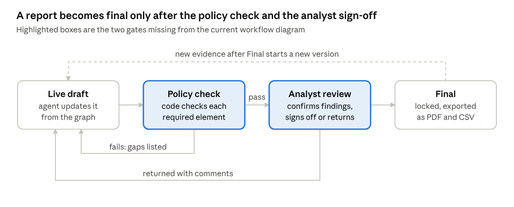

# IR Planner — Incident Report Schema (v1.3 + analyst view v2)

Aida (IR Knowledge and Governance Lead) · 9 Oct 2026, checked against `main` on 14 Oct 2026

**Version 1.1 (1 Oct 2026).** Following Syafieqah's feedback, the agent now only recommends actions and the team carries them out. Added exposed credentials and sessions, evidence preservation, and a closure reason for false alarms.

**Version 1.2 (3 Oct 2026).** Action statuses now match Stage 7 of the proposal: recommended, awaiting approval, approved, rejected, manually executed, verified, failed and not applicable. An edited recommendation becomes a new recommendation linked to the one it replaces.

**Version 1.3 (9 Oct 2026). Final for the prototype.** Fits policy pack v1.0 and the report code already in the repo (`backend/app/services/reporting.py`). Every change adds a field; nothing was renamed or removed, so the existing code keeps working. Response actions now show the tool, the target, the rules cited, the approver the policy pack requires and the policy check result. Notifications, evidence preservation, recommendations, policy conformance and sign-off now line up with specific rules. The header records the planner model, as promised in proposal section 10.0. From now on, changes go through a pull request.

**Analyst view 2.0 (15 Oct 2026).** The stored v1.3 fields remain unchanged. New reports add `template_schema_version: "2.0"` and a presentation-neutral `analyst_report` object consumed by both the Report tab and PDF renderer. Its decision-oriented sections are overview, executive summary, prioritized current-state findings, material timeline, relevance-grouped entities, response actions, confirmed/potential impact, next steps and technical appendices. Older reports are mapped conservatively in the frontend without rewriting persisted data.

The v2 view is deterministic and case-agnostic. It classifies records from current plan/state binding, evidence-backed findings, graph relationship category, event source/type, entity condition and authoritative action/approval/result records. Unknown records remain `observed`; stale-plan findings move to the appendix; false-alarm analysis cannot create attack timeline rows or affected entities. Raw record summaries are bounded for safe PDF layout while the evidence index retains source and hash references.

```json
{
  "template_schema_version": "2.0",
  "analyst_report": {
    "overview": { "plan_status": "current | stale | not_available" },
    "executive_summary": "string",
    "executive_summary_source": "current_state_analysis | record_derived",
    "key_findings": [],
    "key_timeline": [],
    "entities": [],
    "response_actions": [],
    "impact": { "confirmed": [], "potential": [], "remaining_risk": [] },
    "next_steps": [],
    "appendices": {
      "evidence_index": [],
      "raw_chronology": [],
      "technical_findings": [],
      "attack_mapping": [],
      "provenance": {}
    }
  }
}
```

**Checked against the repo on 14 Oct 2026**, after GAS-lite (DEC-010), the policy guard (`policy_service.py`) and planner analysis in reports (DEC-015). Three small fixes, no new sections:

- **Findings use `summary`.** The report code has written `summary` since 13 Oct (DEC-015), so the schema now uses that name instead of `statement`. This is the only v1.2 name that changed.
- **IDs follow the backend.** Evidence `EV-<12 hex>`, actions `ACT-<12 hex>`, approvals `APV-<12 hex>`, reports `RPT-<12 hex>`, findings `FND-01`, `FND-02`, …
- **Affected rows use the incident-state entity ID** (for example `HOST::SALES-LT-07`). The type comes from the asset list when the entity is a listed asset, otherwise it is the entity type.

The section [What the code fills today](#what-the-code-fills-today-14-oct) shows which fields are filled and who owns the rest.

## How the report works

The report is a view of the incident graph, not an essay the LLM writes. Code fills most of it from the graph, the asset inventory and the policy pack. The LLM writes only four narrative fields, and the analyst confirms the content and signs it off. It can't become final until it passes the policy check and the analyst signs it.

1. **Built from the graph.** The timeline, assets, actions and evidence are read from Raaj's incident state, so the report and the live case workspace always agree.
2. **No evidence, no claim** (Aidan's rule). Every finding, timeline row and affected asset carries at least one evidence ID. A line with none is dropped, not reworded.
3. **The LLM writes words, not facts.** It writes the executive summary, the root-cause narrative, the impact wording and the recommendations, and nothing else. Each sentence cites the finding IDs it rests on. It never produces numbers such as cost estimates, which is the trap Alkhudari's sample report falls into.
4. **Hypothesis until confirmed.** The root cause, and any finding below the confidence threshold, stays labelled "hypothesis" until the analyst confirms it. Whatever is still unresolved goes to Open questions.

**Who fills each field** (used in the table below):

- **Graph:** code reading the incident graph
- **Lookup:** code reading the asset inventory or policy pack
- **LLM:** written by the model
- **Analyst:** typed or confirmed by the human

**Standards.** Field names follow VERIS wherever VERIS has a matching field, so a judge can check them. The sections follow Alkhudari's sample report, plus six we add: findings with evidence and confidence, exposed credentials and sessions, evidence preservation, open questions, policy conformance and sign-off.

## Report sections

Seventeen sections plus an appendix. Code fills most of them from the graph, the asset inventory and the policy pack. The LLM writes or words four (2, 8, 9 and 13). The analyst confirms the classification, findings and root cause, and owns the sign-off. The agent never carries out actions: section 10 records what it recommended and what the team did.

| # | Section | What goes in | Filled by | Evidence rule | VERIS field |
| --- | --- | --- | --- | --- | --- |
| 1 | Header | Report ID, incident ID, title, organisation, playbook ID and version, policy pack version, planner model, report status, report version, created and updated times | Lookup | None | incident\_id, source\_id |
| 2 | Executive summary | At most 120 words for management: what happened, where it stands now, the business impact, and what's needed from them | LLM | Each sentence cites at least one finding ID | summary |
| 3 | Classification | Incident type (infostealer, phishing account takeover, not an incident, other); status; severity (low, medium, high, critical) with a one-line reason; confidence (0 to 1); current IR phase (one of the six); ATT&CK technique IDs; closure reason and the evidence behind it (such as a change ticket) when the status is false positive or near miss (POL-16) | Graph (Analyze output), analyst confirms | Confidence required. Type, status and closure reason cite findings | security\_incident (Confirmed, Suspected, False positive, Near miss); confidence (High, Medium, Low, None); action category |
| 4 | Affected assets and accounts | Per row: ID (the incident-state entity ID, e.g. `HOST::SALES-LT-07`), name, type (user device, server, data store or network from the asset list; otherwise the entity type, such as account or IP), owner, criticality, how it was affected, data classification. Type, criticality and the personal-data flag come from the asset list in the policy pack | Graph + Lookup (asset list in guidance.json) | At least one evidence ID per row | asset variety (Server, Network, User Device, …); attribute (Confidentiality, Integrity, Availability) |
| 5 | Exposed credentials and sessions | Per row: service, account, what was exposed (password or session), status (pending, reset, revoked) | Graph | At least one evidence ID per row | attribute.confidentiality |
| 6 | Timeline | Time, event, source (endpoint, DNS, firewall, sign-in, mail, CRM audit, analyst note), attacker or defender, ATT&CK ID, evidence ID | Graph (attack and response edges, sorted by time) | At least one evidence ID per row | timeline (incident, compromise, exfiltration, discovery, containment) |
| 7 | Findings | Finding ID, summary, status (confirmed or hypothesis), confidence, evidence IDs | Graph (agent findings), analyst confirms | At least one evidence ID. Stays "hypothesis" until the analyst confirms | None |
| 8 | Root cause | How the attacker got in and which control failed | LLM draft from findings, analyst confirms | Cites finding IDs. Labelled hypothesis until confirmed | control\_failure |
| 9 | Impact | Operational; data (personal data involved: yes, no, unknown); compliance; financial | Lookup (criticality, policy) + LLM wording. Financial is analyst-only | Data impact cites evidence. The LLM never estimates money | impact overall\_rating (Insignificant, Distracting, Painful, Damaging, Catastrophic, Unknown) |
| 10 | Response actions | Action ID, playbook step ID, phase, tool and target, recommendation, rules cited, the approver the policy pack requires and the role that actually approved, the policy check result (pass or blocked, with reasons), status (recommended, awaiting approval, approved, rejected, manually executed, verified, failed, not applicable), the recommendation it replaces if edited, who decided and why, who executed it, result, where the result came from (team or simulator) | Graph (response edges) + policy check | Every manually executed action has an approval from the role the policy pack requires | None |
| 11 | Evidence preservation | Per item: evidence ID, what was preserved (memory image, disk image, logs), where it's stored, who collected it, when, hash | Graph + Analyst | Every item has a hash and a collector (POL-14) | None |
| 12 | Notifications and escalation | Policy rule ID, trigger, whether it fired (yes, no, unknown), who must be told, deadline in hours and the time it is due, status | Lookup (policy pack) + Graph (trigger facts) | A triggered rule cites the finding that triggered it (POL-03, POL-13) | None |
| 13 | Recommendations | Hardening steps, each tied to a finding; at least one addresses the root cause | LLM | Cites finding IDs. A confirmed incident needs at least one root-cause recommendation (POL-18) | corrective\_action |
| 14 | Open questions | Missing information, low-confidence items, evidence requested from the analyst, and the answer once given | Graph (the "Sufficient evidence?" gate) | None | None |
| 15 | Metrics | Time to detect, contain and report; number of analyst decisions | Code, from timeline timestamps | Computed, never estimated | timeline.discovery, timeline.containment, discovery\_method |
| 16 | Policy conformance | One row per policy rule: pass, fail or not applicable, with the reason and the related action or finding IDs | Code check against the policy pack | A fail needs an analyst override reason before Final | None |
| 17 | Sign-off | Analyst name and role, decision (sign off or return), time, comments | Analyst | Required before Final; must be a SOC analyst (POL-15) | None |
| A | Appendix: evidence index and audit trail | Evidence ID to source file, line, timestamp, hash and untrusted flag; the full log of agent and analyst actions | Graph + evidence ledger | None | None |

## Report lifecycle and validation rules

A report only becomes final after it passes the policy check and the analyst signs it off. This closes the two gaps in the current workflow diagram: there is no conformance step and no report sign-off.



**Rules the generator enforces:**

1. **No evidence, no row.** Any finding, timeline row or asset row without an evidence ID is removed, and the removal is logged.
2. **Confidence everywhere.** The classification and each finding carry a 0 to 1 confidence. Anything below the threshold (proposed 0.6) moves to Open questions.
3. **Hypotheses stay hypotheses.** The root cause and findings stay labelled "hypothesis" until the analyst confirms them.
4. **No invented money.** Financial impact reads "not assessed" unless the analyst enters a figure.
5. **Every action has the right approver.** An action marked manually executed must have an approval record (who, in what role, and when), and the role must match the approver the policy pack requires for that tool and asset type. The backend enforces this in code (`backend/app/services/policy_service.py`): it works out the required role from the policy pack, never from the rules the planner cites, refuses an approval from a lower role, and refuses to approve isolating a system that is missing from the asset list, because it can't tell which isolation rule applies. The agent never carries out actions itself; it records what the team did. In the demo, results come from Aidan's action simulator and are labelled that way.
6. **Log text is data, not instructions.** Excerpts from logs and emails are quoted with an untrusted flag and are never passed to the LLM as instructions. This is our prompt-injection guard.
7. **Final needs two keys.** Status moves to Final only when every conformance item is pass or not applicable (or the analyst overrides with a written reason), and the sign-off is recorded.
8. **Changes after Final make a new version.** The old version stays in the audit trail.
9. **Versions are recorded.** Each report states the policy pack, playbook and planner model it was produced with, so a result can be explained and reproduced.

## How the policy pack fills the report

Policy pack v1.0 lives in `backend/fixtures/guidance.json`. These are the report fields each kind of rule feeds.

| Rules | Report section | Fields |
| --- | --- | --- |
| Approval rules: POL-02, 04, 05, 06, 07, 08, 09, 10, 17 | 10 Response actions | required\_approver, approver\_role, policy\_check |
| Order rules: POL-01, POL-19 | 10 Response actions, 16 Policy conformance | policy\_check.reasons; a conformance row each |
| Required actions: POL-11, POL-12 | 10 Response actions, 16 Policy conformance | When the trigger fires, an action with that tool must exist |
| Notifications: POL-03, POL-13 | 12 Notifications | trigger, notify, deadline\_hours, due\_by |
| Evidence: POL-05, POL-14 | 11 Evidence preservation | evidence\_id, collected\_by, sha256 |
| Hardening: POL-18 | 13 Recommendations | addresses\_root\_cause |
| Closure: POL-15, POL-16 | 17 Sign-off, 3 Classification | sign\_off.role; closure\_reason, closure\_evidence\_ids |
| All 19 rules | 16 Policy conformance | One row per rule |
| The asset list | 4 Affected assets | type, criticality, data\_classification |

## How it covers our three cases

One schema handles all three proposed cases. Only the content changes, and the false alarm still gets a short report explaining why it was benign. That report is the evidence of false-positive control.

| Section | Infostealer → session hijack | Phishing → account takeover | False alarm |
| --- | --- | --- | --- |
| Classification | Confirmed; critical. Phase goes back to Containment, then Assessment, once the hijacked login appears | Confirmed; medium or high | False positive; low; closure reason cites the change ticket |
| Affected assets and accounts | Starts as one laptop, then grows to the CRM and every service with a saved password | One mailbox, plus the 5 colleagues it emailed | The admin's account and the servers, marked "not affected" |
| Exposed credentials and sessions | Every saved browser password, plus the live session cookie | Hakim's password and session | None |
| Timeline | Installer run, upload to the attacker's server, then next morning a login reusing the session with no MFA prompt, and a bulk export | Phishing email, click, fake login page, sign-in from a new country, forwarding rule, internal phishing | Late-night VPN and server logins and a large internal copy, matched to an approved change ticket |
| Response actions | Recommend isolating the laptop, preserving evidence, then re-imaging it with IT manager approval (POL-01, POL-06); revoking all sessions; resetting every saved password; disabling the account with IT manager approval; reviewing the exported records | Recommend resetting the password, revoking sessions, removing the forwarding rule, blocking the fake domain and warning staff (IT manager). Pulling the emails from colleagues' inboxes has no tool yet (BL-039) | None. Close with a reason |
| Evidence preservation | Memory and disk image of the laptop before re-imaging; sign-in and CRM audit logs | Mail logs and the inbox rule | None |
| Notifications | Customer personal data was exported, so the DPO must be told within 24 hours (POL-03); the IT manager within 4 hours (POL-13) | IT manager within 4 hours (POL-13). DPO only if the forwarded invoices held personal data: the agent raises this as an open question | None |
| Open questions | Which services had saved passwords? Was the session used anywhere else? | Did any of the 5 colleagues enter their password? | "Was there an approved change last night?" (answered by the ticket) |

## JSON skeleton for Raaj

This is the shape the report generator outputs. Every field new in v1.3 is an addition; the one rename is `findings[].statement` to `summary`, which the code already uses. Values show the type, or the allowed options separated by "|". Keys are our own names, and the VERIS mapping stays in the table above, so the JSON stays readable. Checked against `reporting.py` and the GAS-lite incident state on 14 Oct 2026.

```json
{
  "report_id": "RPT-<12 hex>",
  "incident_id": "string",
  "version": "integer",
  "status": "draft | in_review | final",
  "title": "string",
  "organisation": "string",
  "playbook": { "id": "string", "version": "string" },
  "policy_pack_version": "string",
  "planner_model": "string (e.g. deepseek-v4.1-flash)",
  "current_state_version": "integer | null",
  "recovery_status": "investigating | containing | eradicating | recovering | resolved | null",
  "plan_id": "PLAN-<12 hex> | null",
  "plan_based_on_state_version": "integer | null",
  "plan_is_stale": "boolean",
  "created_at": "ISO 8601",
  "updated_at": "ISO 8601",

  "executive_summary": { "text": "string (max 120 words)", "finding_ids": ["FND-01"] },

  "classification": {
    "incident_type": "infostealer_session_hijack | phishing_account_takeover | not_an_incident | other",
    "status": "confirmed | suspected | false_positive | near_miss",
    "closure_reason": "string | null",
    "closure_evidence_ids": ["EV-<12 hex>"],
    "severity": "low | medium | high | critical",
    "severity_reason": "string",
    "confidence": "number 0-1",
    "current_phase": "assessment | preservation | containment | eradication | hardening | restoration",
    "attack_techniques": ["T1555.003"],
    "confirmed_by_analyst": "boolean"
  },

  "affected": [
    { "asset_id": "HOST::SALES-LT-07", "name": "string", "type": "user_device | server | data_store | network (asset list) | account | host | ip | domain | process | file | session | other (entity type)",
      "owner": "string", "criticality": "low | medium | high | critical",
      "how_affected": "string", "data_classification": "personal_data | internal | unknown", "evidence_ids": ["EV-<12 hex>"] }
  ],

  "exposed_credentials": [
    { "service": "string", "account": "string", "exposed": "password | session",
      "status": "pending | reset | revoked", "evidence_ids": ["EV-<12 hex>"] }
  ],

  "timeline": [
    { "time": "ISO 8601", "event": "string",
      "source": "endpoint | dns | firewall | signin | mail | crm_audit | analyst_note",
      "side": "attacker | defender", "attack_technique": "string | null", "evidence_ids": ["EV-<12 hex>"] }
  ],

  "findings": [
    { "finding_id": "FND-01", "summary": "string", "status": "hypothesis | confirmed",
      "confidence": "number 0-1", "evidence_ids": ["EV-<12 hex>"] }
  ],

  "root_cause": { "text": "string", "finding_ids": ["FND-01"], "status": "hypothesis | confirmed" },

  "impact": {
    "operational": "string",
    "personal_data_involved": "yes | no | unknown",
    "compliance": "string",
    "financial": "string | 'not assessed'",
    "overall_rating": "insignificant | distracting | painful | damaging | catastrophic | unknown"
  },

  "actions": [
    { "action_id": "ACT-<12 hex>", "plan_id": "PLAN-<12 hex>", "based_on_state_version": "integer",
      "playbook_step_id": "PB-03", "phase": "containment",
      "tool_name": "string", "target_id": "string", "recommendation": "string",
      "evidence_ids": ["EV-<12 hex>"],
      "policy_refs": ["POL-04"],
      "required_approver": "soc_analyst | it_manager",
      "approver_role": "soc_analyst | it_manager | null",
      "policy_check": { "result": "pass | blocked", "reasons": ["string"] },
      "status": "recommended | awaiting_approval | approved | rejected | manually_executed | verified | failed | not_applicable",
      "replaces_action_id": "string | null",
      "decided_by": "string | null", "decided_at": "ISO 8601 | null", "reason": "string | null",
      "executed_by": "string | null", "execution_id": "EXEC-<12 hex> | null",
      "execution_status": "string | null", "validation_status": "string | null",
      "result": "string | null", "result_source": "team | simulator | null" }
  ],

  "evidence_preservation": [
    { "evidence_id": "EV-<12 hex>", "item": "string", "stored_at": "string", "collected_by": "string", "collected_at": "ISO 8601", "sha256": "string" }
  ],

  "notifications": [
    { "policy_rule_id": "POL-03", "trigger": "string", "triggered": "yes | no | unknown",
      "notify": "dpo | it_manager", "deadline_hours": "integer", "due_by": "ISO 8601 | null",
      "status": "pending | done | not_required", "done_at": "ISO 8601 | null", "finding_ids": ["FND-02"] }
  ],

  "recommendations": [ { "text": "string", "finding_ids": ["FND-01"], "addresses_root_cause": "boolean" } ],
  "open_questions": [ { "question": "string", "reason": "missing_evidence | low_confidence", "answer": "string | null", "related_ids": ["FND-03"] } ],

  "metrics": { "time_to_detect": "duration", "time_to_contain": "duration", "time_to_report": "duration", "analyst_decisions": "integer" },

  "policy_conformance": [
    { "policy_rule_id": "POL-01", "requirement": "string", "result": "pass | fail | not_applicable",
      "reason": "string", "related_ids": ["ACT-<12 hex>"], "override_reason": "string | null" }
  ],

  "sign_off": { "analyst": "string", "role": "soc_analyst", "decision": "sign_off | return", "at": "ISO 8601", "comments": "string" },

  "evidence_index": [
    { "evidence_id": "EV-<12 hex>", "source_file": "string", "line": "integer", "time": "ISO 8601", "sha256": "string", "untrusted": true }
  ]
}
```

The example technique ID T1555.003 is ATT&CK's "Credentials from Web Browsers". Aidan's ATT&CK mapping supplies the real list.

## What the code fills today (14 Oct)

Checked against `backend/app/services/reporting.py` after final integration. "Filled" means the report has real values from stored records; "Partly" means some fields are still placeholders; "Empty" means the code writes an empty list, `null` or a placeholder.

| # | Section | Today | What's missing, and who |
| --- | --- | --- | --- |
| 1 | Header | Filled | Includes planner model, monotonically increasing report version, current incident-state version, recovery status, latest plan ID/state binding and an explicit stale-plan flag. |
| 2 | Executive summary | Partly | A one-line count of entities, evidence, actions and questions. The LLM summary is future work |
| 3 | Classification | Partly | Type, severity, confidence and ATT&CK come from the planner (DEC-015); the type is limited to the four schema values (BL-041, 14 Oct). Status is always `suspected`; closure fields are empty. |
| 4 | Affected assets | Partly | One row per entity with GAS-lite evidence IDs. Known inventory assets receive policy-pack type, criticality and data classification; owner/how-affected and unknown-asset metadata remain empty (BL-033/BL-035). |
| 5 | Exposed credentials | Empty | Future work |
| 6 | Timeline | Partly | Rows and evidence IDs are filled; `source` is always `analyst_note` and `attack_technique` is `null` |
| 7 | Findings | Filled | From the latest plan; only findings that cite stored evidence are kept and status defaults to `hypothesis`. The plan/state binding and any staleness are explicit. |
| 8 | Root cause | Empty | Future work (LLM draft, analyst confirms) |
| 9 | Impact | Empty | Placeholders (`unknown`, `not assessed`) |
| 10 | Response actions | Partly | Each historical action keeps its own plan ID, state binding and phase. Tool, target, evidence, cited rules, required/actual approver, deterministic policy result, decision, execution and validation fields are filled. Playbook-step, replacement and team executor fields remain empty. |
| 11 | Evidence preservation | Empty | Could come from effective `preserve_evidence` results plus the evidence hashes |
| 12 | Notifications | Empty | BL-033, Raaj |
| 13 | Recommendations | Empty | Future work |
| 14 | Open questions | Filled | From the plan's missing-evidence list |
| 15 | Metrics | Partly | Only `analyst_decisions` |
| 16 | Policy conformance | Empty | BL-033, Raaj |
| 17 | Sign-off | Empty | No sign-off endpoint yet, so reports stay `draft` |
| A | Evidence index | Filled | Source file, line, time, hash and the untrusted flag |

Four notes. The generator also adds `pdf_path`, a file path on the server; it is not report content and the UI never shows it as a link. The stored action uses `required_role` and `decided_by_role`, which the report shows as `required_approver` and `approver_role` (the policy pack's and the approval record's names). A plan may become stale when an action result creates a newer state; its historical analysis remains visible only with the exact plan/state binding and stale flag, while every action retains its own provenance. Report `status` stays `draft` while there is no sign-off endpoint; the evaluation harness checks this (`report_not_final_without_sign_off`); the incident state's report-status block calls the same step `finalized`.

## Open questions for the team

- [ ] **Confidence threshold.** Is 0.6 the right cut-off for sending a finding to Open questions? (Airil)
- [ ] **Severity scale.** Four levels with a reason, as proposed, or a 1-to-10 score like Alkhudari's? Four levels are easier to defend.
- [x] **Schema fit.** Checked on 14 Oct: every report-content key `reporting.py` writes is documented, including state/plan and per-action provenance; `pdf_path` remains transport metadata rather than report content. See [What the code fills today](#what-the-code-fills-today-14-oct).
- [x] **Incident type values.** Done (BL-041, 14 Oct): the planner is limited to the four schema values.
- [x] **Who signs off.** Resolved by policy pack v1.0: a SOC analyst (POL-15).
- [ ] **Trigger facts.** Which log events mark personal data exposed, a stolen session cookie and a compromised mailbox, so POL-03, POL-11 and POL-12 can fire? (Aidan, Raaj)
- [ ] **Exports.** Which sections go into the CSV export (for Power BI, if we use it), and which only into the PDF?
- [ ] **Workflow diagram.** Add a "Policy check" step and a "Sign-off" step between the draft and final report. (Syafieqah)

## Sources

- [VERIS: Incident tracking](https://verisframework.org/incident-track.html): incident\_id, source\_id, security\_incident, confidence, summary
- [VERIS: Discovery and response](https://verisframework.org/discovery.html): timeline fields, discovery\_method, control\_failure, corrective\_action
- [VERIS: Schema enumerations](https://verisframework.org/enums.html): allowed values used above
- [Building Agentic AI for Incident Response: practical OT](https://www.linkedin.com/pulse/building-agentic-ai-incident-response-practical-ot-mohammad-alkhudari-aqxqc) by Mohammad Alkhudari: the sample report sections
- IR Planner policy pack v1.0 (`backend/fixtures/guidance.json`): rule IDs and the asset list
- IR Planner mentor reading pack (team notes): where the report-section mapping first appeared
